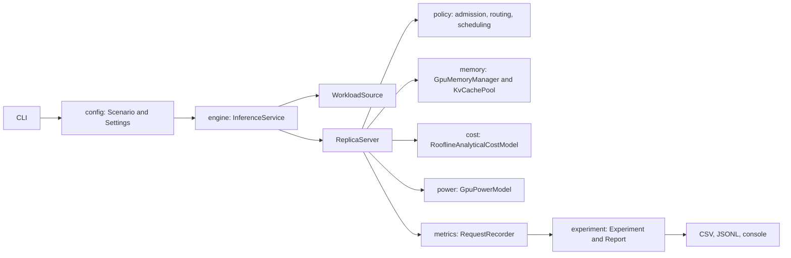
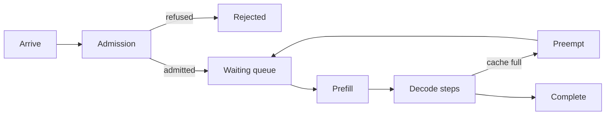
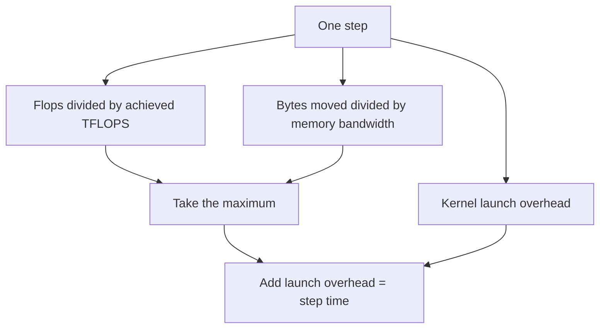
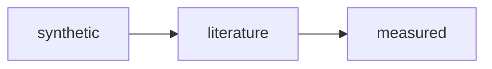

# Docket

A discrete-event simulator for generative-AI (LLM) inference serving. You describe a model, a
device and a stream of requests in a properties file; the simulator replays that stream tick by
tick and returns request-level latency, batching, cache, energy and service-level statistics as
CSV, JSONL and a console report.

It is built on the [PureEdgeSim](https://github.com/CharafeddineMechalikh/PureEdgeSim)
discrete-event engine, so the clock, the event queue and the workload sampling are the same
machinery used for edge-cloud experiments. What is new here is the serving model underneath: a
prefill phase separated from a decode phase, continuous batching, chunked prefill, a paged KV
cache with block rounding, and preemption with recompute.

> **Read the numbers as a check of the mechanics, never as a prediction about hardware.** Every
> figure this repository ships is produced by a synthetic, uncalibrated cost model and a synthetic
> device. The simulator does not measure a real accelerator, and no scenario here should be
> quoted as "what an H100 does". See [Provenance and limits](#provenance-and-limits).

Contents:

- [Why it exists](#why-it-exists)
- [Scope and status](#scope-and-status)
- [Requirements and build](#requirements-and-build)
- [Quick start](#quick-start)
- [The two committed scenarios](#the-two-committed-scenarios)
- [Real trace replays](#real-trace-replays)
- [How the simulator works](#how-the-simulator-works)
- [Configuration reference](#configuration-reference)
- [Policies](#policies)
- [Command line](#command-line)
- [Artifacts](#artifacts)
- [Metrics defined](#metrics-defined)
- [Provenance and limits](#provenance-and-limits)
- [Reproducing the published numbers](#reproducing-the-published-numbers)
- [Testing](#testing)
- [Project layout](#project-layout)
- [Extending the simulator](#extending-the-simulator)
- [Roadmap](#roadmap)
- [License and citation](#license-and-citation)

The [documentation index](docs/README.md) collects the reference pages: architecture,
configuration, cost model, memory and caching, policies, metrics and artifacts, trace replay, and
reproduction.

## Why it exists

Serving an LLM is not one job, it is two. A **prefill** reads the whole prompt in one pass and
fills the KV cache. A **decode** emits one token at a time, re-reading the weights and the cache
on every step. A request is queued, prefilled, then decoded in many steps that may be batched with
other requests, and it may be preempted and recomputed when the cache runs out.

The knobs that decide how that plays out interact: batch ceiling, prefill chunk size, victim
order, cache block size, admission policy, arrival rate. Probing them on real hardware is
expensive and slow. This simulator answers questions of the form "what happens to time-to-first-token
when the cache fills and preemption starts, at this arrival rate, on a device with these limits?"
in seconds, from a text file, without a GPU, and with a deterministic answer that a reviewer can
reproduce.

## Scope and status

This is Stage 1 of the project. It covers one deterministic, single-node deployment and stops
there.

Supported today:

- one device type shared by all replicas, with roofline-limited prefill and decode;
- several replicas of that device (`replicas.count`), with routing across them;
- continuous batching with a sequence ceiling and a per-step token ceiling;
- chunked prefill, so a long prompt can be interleaved with running decodes;
- a paged KV cache with whole-block round-up, admission guards and cache accounting;
- preemption with recompute, with three victim orders;
- per-request metrics: TTFT, TPOT, mean and max inter-token latency, end-to-end, queueing,
  prefill and decode time;
- energy from a two-level power model (idle plus active), integrated over simulated time;
- per-service-class SLO attainment and goodput;
- five arrival patterns, sixteen length distributions and CSV trace replay, with four public serving
  traces replayed under [examples/real-traces](examples/real-traces/README.md);
- a strict properties loader, a CLI, and reproducible CSV, JSONL and console artifacts.

Not in this stage:

- multi-GPU or multi-node topologies, tensor or pipeline parallelism;
- disaggregated prefill and decode on separate pools;
- calibration of the roofline or power model against a real engine or accelerator;
- speculative decoding, prefix caching across requests, or quantized-kernel modelling beyond the
  scalar byte width.

## Requirements and build

- Java 11 or newer. The bytecode target is 11; Maven here runs on JDK 17 and the console runs
  quoted below use a JDK 23 runtime.
- Maven 3.6 or newer.
- No GPU. The PureEdgeSim engine is resolved as a normal Maven dependency.

```bash
git clone https://github.com/CharafeddineMechalikh/Docket.git
cd Docket
mvn clean package
```

This produces `target/docket-1.0.1.jar` and fills `target/lib/` with the runtime
dependencies, so the jar is runnable on its own:

```bash
java -jar target/docket-1.0.1.jar scenarios/single-gpu-poisson.properties
```

Running from loose classes works too:

```bash
java -cp "target/classes:target/lib/*" com.mechalikh.docket.cli.Main \
    scenarios/single-gpu-poisson.properties
```

## Quick start

```bash
mvn -q package
java -jar target/docket-1.0.1.jar -r 3 scenarios/loaded-7b-memory-pressure.properties
```

The console report starts with what ran and how far it can be trusted, then the per-repetition
table:

```text
Docket 1.0.1 | experiment "loaded-7b-memory-pressure"
------------------------------------------------------------------------------
simulated duration   : 30.000 s per repetition
repetitions          : 3, seed 1
model                : big-7b (7000.0M parameters, none), provenance synthetic
device               : gpu-synthetic, provenance synthetic
replicas             : 1
cost model           : roofline-analytical, synthetic, NOT calibrated
overall provenance   : synthetic
policies             : admission=unlimited, routing=least-queued, scheduling=fcfs
workload             : poisson, model big-7b
------------------------------------------------------------------------------
...
```

Artifacts land in `<experiment.outputDir>/<experiment.name>/`. Both committed scenarios set
`experiment.outputDir=target/experiments`, so this run writes
`target/experiments/loaded-7b-memory-pressure/`; a scenario that does not set the key falls back
to `output/`. `-o DIR` overrides the setting.

## The two committed scenarios

`scenarios/` holds two runnable scenarios. Both use the same invented 24 GiB device; what differs
is the model size and the arrival rate, and that difference is the point: it makes the interesting
mechanisms fire.

| Scenario | Model | Arrivals | Regime it demonstrates |
|---|---|---|---|
| `single-gpu-poisson.properties` | 124 M decoder | 6 / min, 60 s | a single replica serves without queueing |
| `loaded-7b-memory-pressure.properties` | 7 B decoder | 120 / min, 30 s | batching caps, chunked prefill, cache refusals, preemption, queue growth |

### Example 1: a light single-GPU run

Six requests per minute for sixty seconds is about six arrivals, easily served by one replica.
Three repetitions with seed 1 produce:

```text
rep   offered completed  success  ttft p50  ttft p99   e2e p99   tpot p99  goodput  tokens/s energy J
1         3         3   1.0000    0.0012    0.0017    0.1876   0.00042     1.0000     19.7   1263.34
2         8         8   1.0000    0.0030    0.0051    0.1760   0.00047     1.0000     26.1   1292.58
3         6         6   1.0000    0.0021    0.0048    0.1275   0.00047     1.0000     18.8   1264.76
```

Everything completes, nothing queues, and the device stays under one percent utilisation. This is
the sanity case: it confirms that a request is admitted, prefilled, decoded and accounted exactly
once.

### Example 2: memory pressure

The 7 B weights leave a small slice of the same 24 GiB for the KV cache, and 120 arrivals per
minute outrun the device. The same three repetitions produce:

```text
rep   offered completed  success  ttft p50  ttft p99   e2e p99   tpot p99  goodput  tokens/s energy J
1        59        35   0.5932    0.1806    0.7182   20.4320   0.05661     0.5932    307.2   4485.05
2        75        44   0.5867    0.1968    1.4289   17.4641   0.05236     0.5867    314.6   4501.42
3        71        31   0.4366    0.2210    0.5052   18.3078   0.07796     0.4366    295.8   4466.40
```

The per-replica line tells the causal story in one row:

```text
replica 0 (big-7b on gpu-synthetic): 111 prefill steps, 756 iterations, batch mean 12.15 peak 20,
preemptions 1, cache refusals 224, stalls 0, peak cache 100.0% of 1249 blocks, utilisation 99.6%,
energy 4485.046 J
```

The batch ceiling is 32, but the cache fills first: peak occupancy reaches 100% of 1249 blocks and
224 allocations are refused, so the batch stops at 20. A request that needs room preempts another
(one preemption in repetition 1), and because arrivals outrun the device the queue grows and
time-to-first-token separates from the service time (p99 TTFT of 0.72 s against a decode step
near 0.05 s). Goodput falls below 1 because the end-to-end target is missed under load. Each of
these is a distinct mechanism the engine exercises.

Both tables are arithmetic means over the three repetitions where the console prints a mean, and
raw repetition rows where it prints rows. The values were produced by the committed code and
scenarios; see [Reproducing the published numbers](#reproducing-the-published-numbers).

## Real trace replays

`examples/real-traces/` replays four public traces through the same engine: Azure's 2023
conversation trace, the Qwen-Bailian trace, the Mooncake conversation trace recorded on Kimi
traffic, and BurstGPT, the bursty dataset NVIDIA's AI Perf replays. Each is cut to a committed
600-request window with a converter, a scenario and a SHA-256 provenance record, so the replays
need no download. The traffic is measured; the latencies and the energy are not, because the
device and the cost model stay synthetic.

| Trace | Completed | TTFT mean / p99 (s) | E2E mean / p99 (s) | Output tok/s | Energy (Wh) | Batch mean / peak |
|---|---|---|---|---|---|---|
| Azure conversation | 600/600 | 0.0249 / 0.0939 | 1.7189 / 3.9139 | 747.1 | 27.77 | 6.70 / 25 |
| Qwen-Bailian trace A | 600/600 | 0.0476 / 0.2797 | 3.3981 / 15.3847 | 812.6 | 40.28 | 8.97 / 29 |
| Mooncake / Kimi | 600/600 | 0.6361 / 5.7174 | 3.1578 / 17.5101 | 325.8 | 482.99 | 0.77 / 2 |
| BurstGPT | 600/600 | 0.0367 / 0.1151 | 0.1013 / 0.8859 | 40.3 | 4.65 | 1.50 / 20 |

`run_replays.sh` runs the four scenarios and `verify_replays.py` reconciles every request row
against the recorded window, so a run that loses, duplicates or rescales an arrival fails. All
four reconcile with a maximum arrival difference of 0 s. The Kimi window also found and fixed a
scheduler liveness defect under long-context memory pressure; both are documented in
[examples/real-traces/README.md](examples/real-traces/README.md).

## How the simulator works

### Packages and the event flow



`InferenceService` is the PureEdgeSim entity that owns the replicas and the workload source.
`WorkloadSource` schedules one arrival event per request. Each arrival is offered to the routing
policy, then to the admission policy, then either refused or placed in a replica queue.
`ReplicaServer` runs the decode loop: it admits the head of the queue when the batch has room,
prefills it (in chunks or in one step), and folds its decode into the running batch on every
iteration. `Report` aggregates the per-request records into the artifacts.

### Request lifecycle



State moves are guarded: a request cannot be queued and decoding at once, and a terminal state
cannot be entered twice. A preempted request returns to the queue and its prompt is recomputed on
the way back, which is why its life-total queueing time can exceed its TTFT.

### What one step costs



The model is a roofline:

```text
step_seconds = max(flops / achieved_flops_per_second,
                   bytes / memory_bandwidth_bytes_per_second)
             + kernel_launch_overhead_seconds
```

Prefill flops scale with the prompt tokens that are not already cached; decode flops are small but
each step re-reads the weights and the whole KV cache, which is why decode is memory-bound and why
batching helps it. The estimate records which term binds (`COMPUTE`, `MEMORY` or `OVERHEAD`) so a
slow step is attributed rather than guessed at. A step above the calibrated support envelope
(more than `cost.supportedMaxBatchSize` sequences or `cost.supportedMaxStepTokens` tokens) is still
priced, but a warning says the answer is an extrapolation.

The model is analytical and uncalibrated: `device.achievedTFLOPS.*` is what you declare, not what
any card does.

### Memory and the KV cache

```text
device memory
  minus unusable fraction          device.unusableMemoryFraction
  minus weights                    parameters x bytes per parameter
  minus runtime overhead           replica.runtimeOverheadGiB
  minus activation reservation     replica.reservedActivationSlots x model.activationBytesPerSequence
  = KV pool
      bytes per token             2 x layers x kvHeads x headDimension x kvBytesPerScalar
      tokens per block            replica.tokensPerBlock
      blocks                      floor(pool / (bytes per token x tokens per block))
```

A sequence reserves whole blocks, so a 1-token growth can cost a full block. When no block is
free, a victim is chosen according to `replica.victimOrder`, suspended, and returned to the queue
if preemption is enabled; otherwise the batch waits for completions. Admission can additionally
refuse a request whose predicted context does not fit, which is how the loaded scenario reaches
100 percent cache occupancy without the queue collapsing.

### Batching, chunked prefill and preemption

- **Continuous batching.** After every decode step a finished sequence leaves and a queued one can
  enter, so the batch is refilled without an idle barrier.
- **Chunked prefill.** With `replica.maxPrefillChunkTokens` set, a long prompt is read in slices,
  and the scheduler may decode other sequences between slices. Setting it to zero reads the whole
  prompt in one step.
- **Preemption with recompute.** A preempted sequence loses its cache, returns to the queue, and
  is prefilled again when it is rescheduled. The metrics keep every queue episode.
- **Deadline abort.** With `replica.abortOnDeadlineMiss=true`, a request past its end-to-end
  deadline is terminated rather than allowed to finish, which trades success ratio for tail
  latency.

### Energy

The device is modelled with two constant power levels. Active seconds are charged at
`device.activePowerWatts`, idle seconds at `device.idlePowerWatts`, and the sum is integrated over
simulated time. Per-request energy is the share of the active interval during which the request
occupied the device, so the per-request rows sum to the device total by construction.

### Determinism

Each repetition binds fresh samplers to a seed derived from `experiment.seed` and the repetition
index. The workload plan copies its distributions per repetition, so repetitions differ while the
same seed reproduces the same run. Ties are broken deterministically (lowest replica id for
routing, arrival order for scheduling), and simultaneous events are ordered by the engine, so a
rerun of the same scenario file, seed and repetition count produces the same summary values.

## Configuration reference

A scenario is a UTF-8 properties file. Every key is read once, and a key that nothing reads is
reported as a warning after the scenario loads, so a misspelled setting does not silently change
what the run means.

Units are part of the key names. Memory is configured in GiB (binary), following how a runtime
reports device capacity. Bandwidth and throughput are decimal (GB/s, TFLOPS), following how a
datasheet writes them.

Values may be overridden on the command line with `-D key=value`, which is how the sweep script
changes one knob at a time.

### `experiment.*`

| Key | Default | Meaning |
|---|---|---|
| `experiment.name` | `run` | Experiment name, also the run directory under the output directory |
| `experiment.durationSeconds` | required | Simulated seconds per repetition, positive and finite |
| `experiment.seed` | `1` | Seed of the first repetition; each repetition derives its own |
| `experiment.repetitions` | `1` | Repetitions per run, at least one |
| `experiment.outputDir` | `output` | Artifact root, resolved against the working directory; `-o` overrides it |
| `metrics.samplingIntervalSeconds` | `1` | Seconds between resource samples; `0` disables the time series |

Relative trace paths are resolved against the scenario file, while the output directory is
resolved against the working directory: an input belongs to the scenario, an output belongs to the
invocation.

### `model.*`

| Key | Default | Meaning |
|---|---|---|
| `model.id` | required | Model identifier, matched against `workload.modelId` |
| `model.name` | `model.id` | Human-readable name |
| `model.version` | empty | Free-form version label |
| `model.architecture` | `dense-transformer` | Free-form architecture label |
| `model.parameterCount` | required | Parameters, with optional `K`, `M`, `B` or `T` suffix, for example `7B` |
| `model.layers` | required | Transformer layers |
| `model.hiddenDimension` | required | Hidden size |
| `model.attentionHeads` | required | Attention heads |
| `model.kvHeads` | `attentionHeads` | Key/value heads, smaller under grouped-query attention |
| `model.headDimension` | required | Head size, in scalars |
| `model.feedForwardDimension` | derived | Feed-forward size, informational |
| `model.vocabularySize` | derived | Vocabulary size, informational |
| `model.maxContextTokens` | required | Context limit, used by validation and warnings |
| `model.precision` | `fp16` | Weight precision: `fp32`, `tf32`, `fp16`, `bf16`, `fp8`, `int8`, `int4` |
| `model.bytesPerParameter` | from precision | Override when the precision is not in the table |
| `model.kvDataType` | `model.precision` | Scalar type of the KV cache |
| `model.kvBytesPerScalar` | from `kvDataType` | Scalar width of the KV cache |
| `model.quantization` | `none` | Label written to the artifacts |
| `model.activationBytesPerSequence` | `0` | Activation footprint reserved per running sequence |
| `model.activeParameterFraction` | `1` | Fraction of parameters touched per token, for sparse models |
| `model.provenance` | `synthetic` | `synthetic`, `literature` or `measured` |

### `device.*`

| Key | Default | Meaning |
|---|---|---|
| `device.id` | required | Device identifier |
| `device.type` | `accelerator` | Free-form device type |
| `device.memoryGiB` | required | Capacity in binary GiB |
| `device.unusableMemoryFraction` | `0.05` | Fraction reserved by the driver, in `[0, 1)` |
| `device.memoryBandwidthGBs` | required | Achieved bandwidth, decimal GB/s |
| `device.achievedTFLOPS.<precision>` | required at least one | Achieved throughput per precision, for example `device.achievedTFLOPS.fp16=312` |
| `device.peakTFLOPS.<precision>` | none | Published peak, informational only |
| `device.idlePowerWatts` | `0` | Power when no sequence runs |
| `device.activePowerWatts` | `0` | Power while at least one sequence runs |
| `device.kernelLaunchOverheadMs` | `0` | Fixed per-step launch cost |
| `device.hostToDeviceBandwidthGBs` | `0` | Transfer bandwidth for models that stream weights |
| `device.hostTransferLatencyMs` | `0` | Fixed transfer latency |
| `device.provenance` | `synthetic` | `synthetic`, `literature` or `measured` |
| `device.note` | empty | Free-form note echoed into the artifacts |

At least one `device.achievedTFLOPS.*` entry is mandatory, and it must cover the model's precision:
the execution model divides by an achieved value and refuses to divide by a peak one.

### `replicas.*` and `replica.*`

| Key | Default | Meaning |
|---|---|---|
| `replicas.count` | `1` | Identical replicas, each on its own device instance |
| `replica.maxBatchSize` | `64` | Largest number of sequences in one decode iteration |
| `replica.maxPrefillChunkTokens` | `2048` | Tokens one prefill step may read; `0` reads the whole prompt |
| `replica.allowPreemption` | `true` | Whether a full cache may suspend a running sequence |
| `replica.victimOrder` | `newest-first` | `newest-first`, `lowest-priority` or `longest-context` |
| `replica.abortOnDeadlineMiss` | `false` | Terminate instead of running past the end-to-end deadline |
| `replica.tokensPerBlock` | `16` | Tokens per cache block, the allocation granularity |
| `replica.runtimeOverheadGiB` | `0` | Bytes the runtime keeps beyond the unusable fraction |
| `replica.reservedActivationSlots` | `0` | Sequences whose activations are reserved out of the KV budget |

Two replicas never share a device instance: each would count the whole memory as its own. Use
`replicas.count` for identical devices, not to model two processes on one card.

### `workload.*`

| Key | Default | Meaning |
|---|---|---|
| `workload.pattern` | `poisson` | `fixed`, `poisson`, `bursty`, `time-varying` or `trace` |
| `workload.intervalSeconds` | `1` | Gap between arrivals for `fixed` and `bursty` |
| `workload.ratePerMinute` | `6` | Mean arrivals per minute, or the default rate of a time profile |
| `workload.burstSize` | `4` | Requests released together under `bursty` |
| `workload.rateProfileMinutes` | none | Ascending minute boundaries of a time profile, comma separated |
| `workload.rateProfilePerMinute` | none | Rates of the profile; `N` rates need `N - 1` boundaries |
| `workload.inputDistribution.name` | required unless trace | Prompt length distribution |
| `workload.inputDistribution.<attribute>` | none | Attributes of that distribution, including `min` and `max` |
| `workload.outputDistribution.name` | none | Generated length distribution |
| `workload.outputDistribution.<attribute>` | none | Attributes of that distribution |
| `workload.outputToInputRatio` | `0` | Alternative to an output distribution: output = ratio x prompt |
| `workload.outputJitterTokens` | `0` | Uniform jitter added to each output length |
| `workload.maxOutputTokens` | `4096` | Hard cap on generated tokens |
| `workload.prediction` | `oracle` | `oracle`, `biased-factor`, `constant` or `trace-observed` |
| `workload.predictionFactor` | `1` | Multiplier applied to the drawn length under `biased-factor` |
| `workload.predictionConstant` | `128` | Constant prediction under `constant` |
| `workload.maxRequests` | unlimited | Cap on arrivals |
| `workload.stopArrivalsAfterSeconds` | none | Stop arrivals at this instant, letting the run drain |
| `workload.priority` | `0` | Priority assigned to generated requests, higher wins |
| `workload.serviceClass` | `default` | Service class used to select the SLO |
| `workload.ttftTargetSeconds` | `0` | TTFT target, measured from arrival |
| `workload.tpotTargetSeconds` | `0` | Per-token target |
| `workload.endToEndTargetSeconds` | `0` | End-to-end target, measured from arrival |
| `workload.cancellationDelaySeconds` | `0` | Client abandonment delay after arrival |
| `workload.modelId` | `model.id` | Model the workload targets |
| `workload.traceFile` | required for trace | CSV trace, resolved against the scenario file |
| `workload.traceTimeScale` | `1` | Multiplier applied to every arrival instant |
| `workload.traceMaxRows` | unlimited | Rows read from the trace |
| `workload.traceDescription` | derived | Written by the loader, not read from the file |

A target or a cancellation delay of `0` means "not stated": the request is then not counted in
that objective, instead of counting as met or missed.

Length distributions are PureEdgeSim distributions, so the names and attributes are shared with the
engine:

| Distribution | Attributes |
|---|---|
| `constant` | `value` |
| `uniform` | `min`, `max` |
| `triangular` | `min`, `mode`, `max` |
| `normal` | `mean`, `std` |
| `lognormal` | `mean`, `std` |
| `exponential` | `mean` |
| `gamma` | `shape`, `scale` |
| `erlang` | `shape`, `scale` |
| `weibull` | `shape`, `scale` |
| `pareto` | `scale`, `shape` |
| `beta` | `alpha`, `beta` |
| `poisson` | `mean` |
| `bernoulli` | `probability` |
| `geometric` | `probability` |
| `binomial` | `trials`, `probability` |
| `categorical` | `values`, optional `weights` |

Any distribution can also carry `min` and `max` to bound it from below and above.

#### Prediction modes

The controller in a real engine does not know how many tokens a request will generate. The
`workload.prediction` key decides what the admission and scheduling policies are allowed to see:

| Mode | What the controller sees | Meaning |
|---|---|---|
| `oracle` | The drawn length | An upper bound on any deployable controller |
| `biased-factor` | Drawn length x `predictionFactor` | A systematic over- or under-estimate |
| `constant` | `predictionConstant` tokens | A fixed guess |
| `trace-observed` | The length recorded in the trace | The oracle available to a replay |

The record and the artifact keep both numbers, so a result can say whether a gain comes from
better scheduling or from a better length predictor.

#### Trace replay

A trace is a CSV file read by header name, not by column position, so a file exported by another
tool can be replayed without rearranging the columns.

Required columns:

| Column | Meaning |
|---|---|
| `arrival_time_s` | Arrival instant in seconds, non-decreasing down the file |
| `model_id` | Model the request targets |
| `input_tokens` | Prompt length |
| `output_tokens` | Observed generated length |

Optional columns, each defaulting to an unstressed single-tenant request:

| Column | Meaning |
|---|---|
| `priority` | Scheduling priority, higher wins |
| `service_class` | Service class used for SLO accounting |
| `session_id` | Session identifier, kept in the record |
| `ttft_target_s` | TTFT target from arrival |
| `e2e_target_s` | End-to-end target from arrival |
| `tpot_target_s` | Per-token target |
| `cancellation_delay_s` | Client abandonment delay from arrival |

```properties
workload.pattern=trace
workload.traceFile=../configs/traces/my-trace.csv
workload.traceTimeScale=0.25
workload.prediction=trace-observed
```

`workload.traceTimeScale` multiplies the arrival instants, which is how a trace recorded at one
intensity is replayed at another. The source file and the transformations applied are echoed into
`config.txt` as a `# Trace:` line.

The four committed windows under [examples/real-traces](examples/real-traces/README.md) show the
whole path: a downloader, a converter that records its window and SHA-256 in `manifest.json`, one
scenario per trace and a reconciliation script that compares the run with the recording.

### `policy.*`

| Key | Default | Meaning |
|---|---|---|
| `policy.admission` | `unlimited` | One policy, or a comma-separated chain applied in order |
| `policy.admission.class` | unset | Fully qualified class of a custom admission policy; wins over `policy.admission` |
| `policy.queueLimit.maxWaitingRequests` | required when used | Cap on queued requests per replica |
| `policy.cacheCapacity.headroomTokens` | `0` | Tokens kept free beyond the predicted context |
| `policy.predictedDeadline.tolerance` | `1` | Fraction by which the predicted wait may exceed the slack |
| `policy.routing` | `least-queued` | `round-robin`, `least-queued` or `least-predicted-work` |
| `policy.routing.class` | unset | Fully qualified class of a custom routing policy; wins over `policy.routing` |
| `policy.scheduling` | `fcfs` | `fcfs`, `priority`, `shortest-expected-first` or `shortest-oracle-first` |
| `policy.scheduling.class` | unset | Fully qualified class of a custom scheduling policy; wins over `policy.scheduling` |

A custom class is loaded from the classpath of the running simulation, so an external policy needs
no patch to the simulator: implement the interface, add the directory holding it to `java -cp` next
to the jar, and name it in the scenario. The class needs a public no-argument constructor.

### `cost.*`

| Key | Default | Meaning |
|---|---|---|
| `cost.model` | `roofline-analytical` | The only implemented execution cost model |
| `cost.supportedMaxBatchSize` | largest replica batch | Batch size above which a step is flagged as extrapolated |
| `cost.supportedMaxStepTokens` | `16384` | Step tokens above which a step is flagged as extrapolated |

## Policies

### Admission

Admission decides whether an arriving request enters the service at all. A chain is applied in
order and the first refusal wins.

| Policy | Rule | Refusal reason |
|---|---|---|
| `unlimited` | Always admits | none |
| `queue-limit` | Refuses once the replicas together hold `maxWaitingRequests` queued requests | `admission_queue_limit` |
| `cache-capacity` | Refuses unless some replica can hold the predicted final context plus the headroom | `admission_no_cache_capacity` |
| `predicted-deadline` | Refuses when the least pending work exceeds the TTFT slack times `1 + tolerance` | `admission_deadline_infeasible` |

`predicted-deadline` is deliberately conservative: the pending work is a lower bound on the wait,
because running sequences keep decoding while the request waits.

### Routing

Routing chooses a replica when more than one can serve the request. All three break ties by the
lowest replica index, so the choice is deterministic.

| Policy | Rule |
|---|---|
| `round-robin` | Rotates through the replicas in order |
| `least-queued` | Chooses the replica with the fewest waiting requests |
| `least-predicted-work` | Chooses the replica whose queued work, in expected step-seconds, is smallest |

### Scheduling

Scheduling orders the waiting queue of one replica.

| Policy | Order | Sees |
|---|---|---|
| `fcfs` | Arrival order | Nothing |
| `priority` | Higher priority first, then arrival | The declared priority |
| `shortest-expected-first` | Shortest expected work first | The predicted output length |
| `shortest-oracle-first` | Shortest total work first | The drawn output length |

The last one is an oracle baseline: it shows what a perfect length predictor would buy, and it is
not deployable.

Writing your own is supported without touching the engine. The nine worked examples under
[examples/](examples/README.md) each define a policy, pair it with the built-in baseline on the same
workload and report what changed. They cover deadline-aware ordering, class reservations, class
objectives, session affinity, weighted load, composite admission, abort on miss, length-aware
routing under saturation and a hand-written template clone of `fcfs`.

## Command line

```text
usage: docket [options] <scenario.properties>

  -c, --scenario FILE     the scenario to run
  -o, --output DIR        override experiment.outputDir
  -s, --seed N            override experiment.seed
  -r, --repetitions N     override experiment.repetitions
  -D key=value            set or override any scenario property
  -q, --quiet             write the artifacts without the console report
  -h, --help              show this message
  --version               show the version
```

Examples:

```bash
# three repetitions, artifacts under results/loaded
java -jar target/docket-1.0.1.jar \
    -r 3 -o results scenarios/loaded-7b-memory-pressure.properties

# change one knob without editing the file
java -jar target/docket-1.0.1.jar \
    -D replica.maxBatchSize=8 scenarios/loaded-7b-memory-pressure.properties

# quiet run for scripts
java -jar target/docket-1.0.1.jar -q scenarios/single-gpu-poisson.properties
```

Exit codes:

| Code | Meaning |
|---|---|
| `0` | The experiment finished and its artifacts were written |
| `2` | Usage error: bad flag, missing file, unreadable path |
| `3` | The scenario does not load: missing key, bad value, unreadable trace |
| `4` | The run failed or an artifact could not be written |

A warning about an unused key is printed but does not change the exit code; the run still
completes. The warning exists because a silently ignored key is how a result ends up describing
something other than what its author wrote.

## Artifacts

Every run writes under `<experiment.outputDir>/<experiment.name>/`:

```text
summary.csv           one row per repetition: aggregates and per-metric summaries
slo.csv               attainment per service class and objective, one row per combination
config.txt            the resolved scenario, the provenance of the weakest input, and caveats
rep01/requests.csv    one row per request, 50 columns
rep01/requests.jsonl  the same rows as JSON lines
rep01/samples.csv     periodic resource samples, one row per replica and instant
rep02/...
```

### `summary.csv`

One row per repetition, 71 columns: the identifying columns (`experiment`, `repetition`, `seed`,
`cost_model`), the aggregates (`duration_s`, `requests_offered`, `requests_completed`,
`success_ratio`, `requests_with_objective`, `requests_within_objective`, `goodput`,
`tokens_generated`, `tokens_per_second`, `requests_per_second`), six summary statistics (mean,
p50, p90, p95, p99, max) for each of the seven metrics (`ttft_s`, `e2e_s`, `tpot_s`, `mean_itl_s`,
`queueing_s`, `prefill_s`, `decode_s`), the energy columns (`energy_j`, `energy_wh`), the device
aggregates (`device_utilisation`, `replicas`, `mean_batch`, `peak_batch`, `decode_iterations`,
`prefill_steps`, `preemptions`, `cache_refusals`, `stalled_steps`, `peak_cache_occupancy`,
`sampler_bindings`), the calibration label (`cost_calibration`) and the outcome histogram
(`outcomes`, as `reason:count` pairs).

### `requests.csv`

One row per terminal request, 50 columns:

| Group | Columns |
|---|---|
| Provenance | `experiment`, `seed`, `repetition`, `cost_model`, `cost_provenance`, `cost_calibrated`, `model_provenance`, `device_provenance` |
| Identity | `request_id`, `model_id`, `replica_id`, `tenant_id`, `service_class`, `priority`, `session_id` |
| Timeline | `arrival_time_s`, `admitted_time_s`, `queue_entry_time_s`, `prefill_start_time_s`, `first_token_time_s`, `last_token_time_s`, `terminal_time_s` |
| Outcome | `final_state`, `outcome_reason` |
| Work | `input_tokens`, `output_tokens_requested`, `output_tokens_generated`, `predicted_output_tokens`, `cached_tokens`, `allocated_blocks` |
| Latency | `ttft_s`, `tpot_s`, `mean_itl_s`, `max_itl_s`, `e2e_s`, `queueing_s`, `prefill_s`, `decode_s` |
| Energy | `energy_j`, `energy_wh` |
| Preemption | `preemptions` |
| Targets | `ttft_target_s`, `e2e_target_s`, `tpot_target_s`, `cancellation_time_s` |
| SLO flags | `ttft_met`, `e2e_met`, `tpot_met`, `all_slo_met` |
| Accounting | `decode_iterations_expected` |

Durations are measured from arrival, except `prefill_s` and `decode_s`, which measure the work
itself. A request that never reached a phase carries an empty cell or `NaN` there, rather than a
zero that would read as instantaneous.

### `samples.csv`

One row per replica per sampling instant:

```text
time_s,replica_id,running_sequences,waiting_requests,used_blocks,total_blocks,reserved_tokens,cache_occupancy,energy_j,executing
```

`executing` is `true` when at least one sequence decoded during the interval. This series is what
a time plot of batch size, queue length and cache occupancy should be drawn from.

### `slo.csv`

```text
experiment,repetition,service_class,objective,offered,completed,applicable,met,attainment
```

`objective` is one of `ttft`, `e2e`, `tpot` or `all`. `applicable` counts the requests of that
class that stated the objective, so a class without targets is reported with
`applicable=0` rather than a fabricated 100 percent.

### `config.txt`

The resolved scenario (model, device, deployment, cost model, workload, policies) followed by the
provenance of the weakest input, the calibration state of the cost model, any warning the run
produced, the trace description when the workload replays a file, and the pooled summary of each
metric. An artifact therefore carries the inputs that made it, not only the numbers it produced.

## Metrics defined

- **TTFT** (`ttft_s`): arrival to first emitted token, across all attempts.
- **TPOT** (`tpot_s`): `(last token - first token) / (tokens - 1)` over the decode phase.
- **Mean ITL** (`mean_itl_s`): mean of the per-iteration gaps between emitted tokens.
- **End-to-end** (`e2e_s`): arrival to last token, defined only for completed requests.
- **Queueing** (`queueing_s`): life-total time in a waiting queue, summed over every episode, so it
  can exceed TTFT after a preemption.
- **Prefill** and **decode** (`prefill_s`, `decode_s`): the work itself, summed over all attempts.
- **Success ratio**: completed requests over offered requests.
- **Goodput**: the fraction of offered requests that completed within every stated target.
- **Utilisation**: the fraction of simulated time in which at least one sequence was decoding.

Percentiles use linear interpolation between ranks (the NumPy default), so the console, the CSV
and a Pandas reading of the same rows agree.

Two summaries are reported side by side. The **pooled** summary collects every request row of
every repetition and answers "what did this deployment do to a request". The **across-repetition**
summary collects the per-repetition means and answers "how much does the answer move when the seed
changes"; it prints a standard error, and with one repetition it prints zero spread because one
observation contains no information about spread.

## Provenance and limits

Every input carries a provenance label, and the scenario reports the weakest of them:



| Label | Meaning |
|---|---|
| `synthetic` | Invented for the scenario; comparable in magnitude, not descriptive of a real part |
| `literature` | Taken from a published specification or paper |
| `measured` | Produced by a measurement on this machine or a named device |

The cost model is `roofline-analytical` and uncalibrated. Two consequences follow, and they are
stated in every artifact:

- The device reports an *achieved* throughput and bandwidth. Those figures are declared in the
  scenario, not measured here.
- Weights are charged once per step, which assumes a fused kernel; the KV cache is charged as a
  full read per step, which is the pessimistic end of a paged layout. Both assumptions are
  listed in the cost model's own notes and echoed into `config.txt`.

Using the simulator to compare two configurations of the *same* synthetic device is sound: both
sides carry the same assumptions. Using it to predict a real GPU is not sound until the model is
calibrated against one. The provenance lattice exists so that a calibrated run cannot be confused
with an uncalibrated one.

No provider trace is used to claim a latency, an energy figure or a calibrated result. Four public
traces are replayed under [examples/real-traces](examples/real-traces/README.md), and what they
make measured is the traffic: arrivals and both lengths. The time a step takes still comes from
the uncalibrated roofline model on a synthetic device, so those runs print `overall provenance :
synthetic` like every other run here, and no result in this repository should be read as
reproducing production latency.

## Reproducing the published numbers

The repository ships the driver that produced the paper's sweep:

```bash
mvn -q package
bash scripts/run_sweeps.sh                 # 19 configurations, three repetitions each
python scripts/plot_sweeps.py              # figures from target/sweep into target/figures
```

`run_sweeps.sh` writes under `target/sweep` by default (pass another directory as its first
argument), and ends with `SWEEP_DONE fail=0` when every configuration completed. Each
configuration is a `-D` override of a committed scenario, so the sweep is a list of explicit
settings rather than a second scenario format.

Determinism: the same scenario file, seed and repetition count regenerate byte-identical summary
files. Two runs on the same machine produce the same `summary.csv`; the per-request files contain
the same values with the same column order.

The scenarios in this README were produced with:

```bash
java -jar target/docket-1.0.1.jar -r 3 scenarios/single-gpu-poisson.properties
java -jar target/docket-1.0.1.jar -r 3 scenarios/loaded-7b-memory-pressure.properties
```

on a Windows host with a JDK 23 runtime, seed 1, with the committed build. The paper reports the
arithmetic mean over the repetitions; the console tables above report the individual repetitions.

The real trace replays are regenerated and reconciled with:

```bash
bash examples/real-traces/run_replays.sh      # -> target/trace-replays, ends with REPLAY_CHECK OK
```

The captures archived under `examples/real-traces/results/` came from that script on the same
host, and `examples/real-traces/data/manifest.json` records the SHA-256 of every upstream file.

## Testing

```bash
mvn test
```

The suite runs on JUnit 5 against the real engine, with no stubs and no simulated success:

| Layer | Tests | What it establishes |
|---|---|---|
| Unit | 78 | Request lifecycle and latency math, the roofline model against hand-computed anchors, paged-cache rounding and refusals, the energy integral, percentile and SLO helpers, the strict settings reader |
| Integration | 6 | The same seed reproduces a run, a different repetition salt changes it, utilisation rises with offered load, and a trace whose suspended prefills fill the cache still completes every request |
| Invariant | 2 | Nineteen assertions re-derive the accounting from the exposed counters of a finished run |
| Regression | 3 | The two scenarios are pinned to freshly measured goldens |
| Command line | 16 | Exit codes, `-D` overrides, artifact layout, the unused-key warning, JSON quoting |
| Examples | 35 | The class-loading hook and its three error paths, each example policy against a hand-built load snapshot, and every example scenario loading and running |

Total: 140 tests. A full run takes about fifteen seconds on the development machine.

The invariant layer is the important one for published results. The result object verifies itself
when it is built: every arrived request is terminal exactly once, completed requests do not
outnumber terminal ones, good requests do not outnumber requests with an objective, device energy
equals the sum over replicas and is at least the idle floor, utilisation lies in `[0, 1]`, pooled
statistics equal the sums over request rows, and no reservation exceeds the pool. The invariant
tests recompute the same facts independently, so a refactor that removes an internal guard without
changing the numbers still fails the build.

## Project layout

```text
Docket/
├── pom.xml
├── README.md
├── LICENSE                       GPL-3.0
├── scenarios/                    the two committed, runnable scenarios
├── examples/                     nine policy examples, their scenarios, tests and results
│   ├── README.md                 the index and the measured headline of each example
│   ├── common.sh                 classpath and run helpers shared by the example scripts
│   ├── data/                     the generated SLA and session workloads
│   └── real-traces/              public trace windows, scenarios, converter and replay check
├── scripts/
│   ├── run_sweeps.sh             the 19-configuration sweep driver
│   └── plot_sweeps.py            figures from the sweep output
├── docs/                         detailed reference pages (see docs/README.md)
├── configs/                      reserved for reusable fragments (hardware, models)
├── results/                      reserved for published artifact sets
└── src/
    ├── main/java/com/mechalikh/docket/
    │   ├── cli/                  argument parsing and exit codes
    │   ├── config/               Settings, Scenario and TraceLoader
    │   ├── domain/               request, model, device, provenance, states
    │   ├── engine/               service, replica loop, workload plan and source
    │   ├── policy/               admission, routing and scheduling strategies
    │   ├── memory/               memory split and paged KV pool
    │   ├── cost/                 roofline model and its estimate
    │   ├── power/                two-level power integration
    │   ├── metrics/              per-request recording, samples, percentiles, SLO
    │   └── experiment/           runner, run result and report
    └── test/java/com/mechalikh/docket/
        ├── unit/ integration/ invariant/ regression/ cli/ support/
        └── examples/             the nine example policies and their scenarios
```

`configs/` and `results/` are placeholders kept in the tree for the next stage; they are not used
by the build or by the tests. `examples/real-traces/` is self-contained and is driven by its own
scripts, not by Maven. The policy classes of `examples/` are compiled into the test classpath by
`build-helper-maven-plugin`, so they are exercised by `mvn test` and never enter the jar.

## Extending the simulator

**A new policy.** Implement `AdmissionPolicy`, `RoutingPolicy` or `SchedulingPolicy` with a public
no-argument constructor, put the compiled class on the runtime classpath and name it in
`policy.admission.class`, `policy.routing.class` or `policy.scheduling.class`. No dependency on the
simulator's internals is needed beyond the interface and the `ReplicaLoad` snapshot. The policy
receives the request and the load snapshot and returns a decision; it must not mutate engine state.
The [examples](examples/README.md) show the full loop, tests included. A built-in policy that
belongs in the engine still needs one `case` in the matching factory method in `Scenario` and one
clause in its error message.

**A new workload pattern.** Add a constant to `WorkloadPlan.Pattern`, extend `validate()` with its
required settings, extend the arrival drawing in `WorkloadSource`, and extend `describe()` so the
artifact names it.

**A new cost model.** Implement `ExecutionCostModel`. `Scenario.costModel` currently accepts only
`roofline-analytical` and says so in its error message; relax that switch when a second model
exists. A calibrated model should return `isCalibrated() == true` and name its
`calibrationSource()`, which flips the provenance lattice for the whole run.

**A new artifact column.** Append it to the header in `RequestRecorder.HEADER` and to the row
builder in the same class, and add its aggregate to `RunResult` if it belongs in `summary.csv`. The
invariant tests compare pooled statistics against the per-request rows, so a column that does not
sum correctly fails the build.

## Roadmap

Ordered by what would most improve the evidence, not by effort:

1. Calibrate the roofline coefficients against one serving engine on one device, and label the
   result `measured`. The trace replays already fix the traffic; this fixes the speed.
2. Replay more than 600 rows, and add a workload whose trace states SLO targets, so goodput is
   measured rather than reported as not applicable.
3. Multi-GPU and multi-node topologies, with tensor and pipeline parallelism.
4. Disaggregated prefill and decode on separate pools.
5. Prefix caching across requests, so a shared prompt prefix is not recomputed and the session
   identifiers recorded by the Qwen and Mooncake traces can be routed.
6. An HTTP or gRPC front end, so the simulator can sit behind a load generator.

Calibration changes what the numbers mean; the rest extends what can be simulated. Until it is
done, every result in this repository, including the trace replays, is a statement about the
simulator, not about a deployment.

## License and citation

Docket is released under the GNU General Public License v3.0, the same license as the
PureEdgeSim engine it builds on. Every source file carries the GPL header.

If you use it in academic work, cite the repository and the engine:

```bibtex
@software{mechalikh_docket,
  author  = {Mechalikh, Charafeddine},
  title   = {{Docket}: a discrete-event simulator for generative AI inference serving},
  year    = {2026},
  version = {1.0.1},
  url     = {https://github.com/CharafeddineMechalikh/Docket},
  license = {GPL-3.0}
}
```
