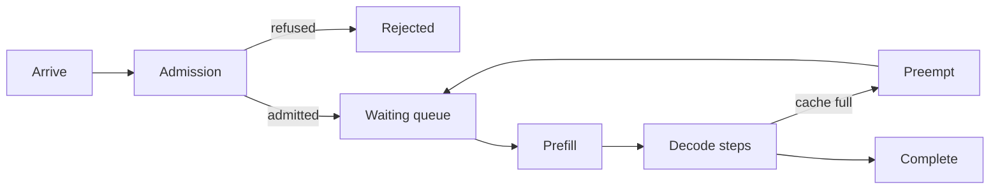
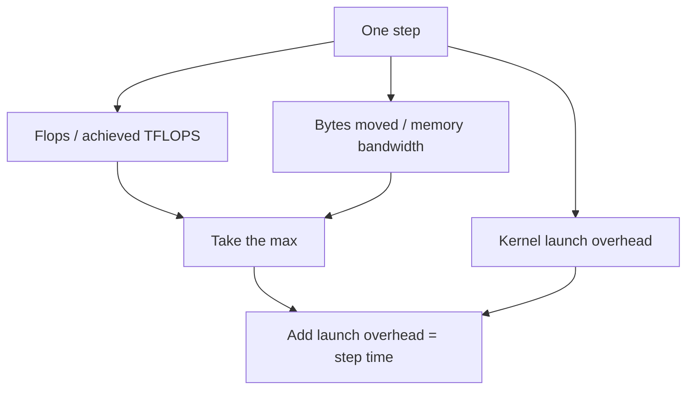

# GenAIInferenceSim

A discrete-event simulator for generative-AI (LLM) inference serving. You describe one GPU, one
model and a stream of requests in a properties file; the simulator replays that stream tick by tick
and returns request-level latency, batching, cache, energy and service-level statistics as CSV,
JSONL and a console report.

It is built on the [PureEdgeSim](https://github.com/CharafeddineMechalikh/PureEdgeSim) discrete-event
engine, so the arrival process, the scheduling and the clock are the same machinery that drives
edge-cloud experiments; what is new here is the serving model underneath it: prefill versus decode,
continuous batching, chunked prefill, a paged KV cache, and preemption with recompute.

> **Read the numbers as a check of the mechanics, never as a prediction about hardware.** Every
> figure this repository ships is produced by a synthetic, uncalibrated cost model and a synthetic
> device. The simulator does not measure a real accelerator, and no scenario here should be quoted
> as "what an H100 does". See [Provenance and limits](#provenance-and-limits).

## What it is for

Serving an LLM is not one job, it is two: a **prefill** that processes the whole prompt in one
pass and fills the KV cache, then a **decode** that emits one token at a time, re-reading the
weights and the cache each step. A request spends time queued, then in prefill, then in many decode
steps that may be batched with other requests, and it may be preempted and recomputed if the cache
runs out. The knobs that decide how that plays out (batch ceiling, prefill chunk size, victim order,
cache block size, admission policy) interact in ways that are expensive to probe on real hardware.

This simulator lets you ask "what happens to time-to-first-token when the cache fills and preemption
starts, at this arrival rate, on a device with these limits?" and get a deterministic, reproducible
answer in seconds, from a text file, without a GPU.

## Stage 1 scope

This is Stage 1 of the project. It covers a single deterministic setup and stops there:

- one device (GPU/accelerator) with roofline-limited prefill and decode;
- continuous batching with a batch-token ceiling, and chunked prefill;
- a paged KV cache with block round-up, and preemption-with-recompute when it fills;
- request-level metrics: TTFT, TPOT, mean inter-token latency, end-to-end, and life-total queueing;
- energy from a piecewise power model (idle plus active, integrated over time);
- per-class SLO attainment and goodput;
- a strict properties-file loader, a CLI, and reproducible artifacts.

Multi-GPU, multi-node, disaggregated prefill/decode, real engine calibration, and trace-driven
replay against a serving stack are **not** in this stage.

## Build and run

Java 11 or newer and Maven are enough. The PureEdgeSim engine is resolved as a normal Maven
dependency.

```bash
mvn -o clean package
java -cp "target/classes:target/lib/*" com.mechalikh.genaism.cli.Main \
    scenarios/single-gpu-poisson.properties
```

The CLI takes a scenario file and a handful of overrides:

```text
  -c, --scenario FILE     the scenario to run (or pass it as the last argument)
  -o, --output DIR        override experiment.outputDir
  -s, --seed N            override experiment.seed
  -r, --repetitions N     override experiment.repetitions
  -D key=value            set or override any scenario property
  -q, --quiet             write the artifacts without the console report
```

The loader is strict: a key the code never reads is reported as a warning rather than silently
ignored, because a scenario that sets `replica.maxBatchSize` but is running an ignored value means
something other than what its author wrote. A run exits non-zero when the scenario does not load
(`3`) or when the run fails an invariant (`4`), distinct from a usage error (`2`).

## The two committed examples

`scenarios/` holds two runnable scenarios. Both use the same invented 24 GB device; what differs is
the model size and the arrival rate, and that difference is the whole point: it is what makes
interesting mechanisms fire.

| Scenario | Model | Arrivals | Regime it demonstrates |
|---|---|---|---|
| `single-gpu-poisson.properties` | 124 M decoder | 6 / min, 60 s | a single replica serves without queueing |
| `loaded-7b-memory-pressure.properties` | 7 B decoder | 120 / min, 30 s | batching caps, chunked prefill, cache refusals, preemption, queue growth |

### Example 1: a light single-GPU run

Six requests per minute for sixty seconds is about six arrivals, easily served by one replica. This
run (3 repetitions, seed 1) freshly produced:

```text
rep   offered completed  success  ttft p50  ttft p99   e2e p99   tpot p99  goodput  tokens/s energy J
1         3         3   1.0000    0.0012    0.0017    0.1876   0.00042     1.0000     19.7   1263.34
2         8         8   1.0000    0.0030    0.0051    0.1760   0.00047     1.0000     26.1   1292.58
3         6         6   1.0000    0.0021    0.0048    0.1275   0.00047     1.0000     18.8   1264.76
```

Everything completes, queueing is zero because nothing waits, and the device barely works
(utilisation under 1%). This is the sanity case: it confirms a request is admitted, prefilled,
decoded and accounted exactly once.

### Example 2: memory pressure

The 7 B weights leave only a small slice of the same 24 GB for the KV cache, and 120 arrivals per
minute outrun the device. The freshly measured run shows the serving path under load:

```text
rep   offered completed  success  ttft p50  ttft p99   e2e p99   tpot p99  goodput  tokens/s energy J
1        59        35   0.5932    0.1806    0.7182   20.4320   0.05661     0.5932    307.2   4485.05
2        75        44   0.5867    0.1968    1.4289   17.4641   0.05236     0.5867    314.6   4501.42
3        71        31   0.4366    0.2210    0.5052   18.3078   0.07796     0.4366    295.8   4466.40
```

The per-replica line tells the causal story in one row:

```text
replica 0 (big-7b on gpu-synthetic): 111 prefill steps, 756 iterations, batch mean 12.15 peak 20,
preemptions 1, cache refusals 224, stalls 0, peak cache 100.0% of 1249 blocks, utilisation 99.6%,
energy 4485.046 J
```

The batch ceiling is 32, but the cache fills long before that: peak occupancy hits 100% of 1249
blocks and 224 allocations are refused, so the batch stops at 20. The cache is full, so a request
that needs room preempts another (1 preemption), and because arrivals outrun the device the queue
grows and time-to-first-token separates from the raw service time (p99 TTFT of 1.43 s against a
0.05 s decode step). Goodput drops below 1 because the end-to-end target is missed under load. Every
one of these is a distinct mechanism the engine exercises.

## How a request moves through the engine



The scheduler picks the head of the queue, prefills it (possibly in chunks), then folds its decode
into the running batch each step. When the cache cannot give a sequence another block, the victim
policy chooses a sequence to evict; an evicted request returns to the queue and its prompt is
recomputed on the way back. Admission, routing and scheduling are each pluggable strategies selected
by name in the scenario file.

## What one step costs



Prefill flops scale with prompt length; decode flops are small but re-read the weights and the whole
KV cache every emitted token, which is why decode is memory-bound and batching helps it. The step
time is the roofline maximum of the compute term and the memory term, plus a launch-overhead constant
that dominates tiny batches. Which term binds is reported so a slow step is attributed to the right
cause rather than guessed at.

## Metrics defined

- **TTFT** (`ttft_s`): arrival to first emitted token.
- **TPOT** (`tpot_s`): wall-clock `(last - first) / (tokens - 1)` over the decode phase.
- **Mean ITL** (`mean_itl_s`): mean of the per-iteration gaps.
- **End-to-end** (`e2e_s`): arrival to last token; only defined for completed requests.
- **Queueing** (`queueing_s`): life-total time spent waiting, summed over every queue episode, so it
  can exceed TTFT once a request is preempted mid-decode and re-queued after its first token.
- **Goodput**: the fraction of offered requests that finish within their stated service-level targets.

Percentiles use linear interpolation between ranks (the NumPy default), so the console and CSV agree
with what a Pandas/NumPy reader would compute from the same rows.

## Artifacts

Each run writes, under the output directory and one folder per repetition:

```text
summary.csv          one row per repetition: every aggregate above
slo.csv              attainment per service class and objective
config.txt           the effective configuration with the provenance of each input
rep01/requests.csv   one row per request: timestamps, states, tokens, latencies, energy, SLO flags
rep01/requests.jsonl the same rows as JSON lines
rep01/samples.csv    periodic device samples: occupancy, batch size, utilisation
```

A run is reproducible from the file that produced it plus its seed and the PureEdgeSim version;
`config.txt` echoes the effective configuration next to the numbers so an artifact carries the
inputs that made it.

## Provenance and limits

The cost model in both examples is `roofline-analytical`: **analytical and uncalibrated**. No timing
from a real model, device or serving engine was used. What that means in practice:

- the device reports an *achieved* throughput and bandwidth, never a marketing peak, but those
  figures are invented so that the roofline terms are comparable in size, not to describe any card;
- weights are charged once per step, which assumes a fused kernel; a backend that re-reads them per
  layer would be slower;
- the KV cache is charged as a full read per step, which is the pessimistic end of what a real paged
  layout does;
- every artifact row carries `cost_provenance=synthetic`, and the console prints the weakest
  provenance among the inputs, so no output can accidentally look measured.

The simulator is honest about which numbers are estimates: it will tell you a duration is a roofline
bound, not a measurement. Using it to compare two configurations of the *same* synthetic device is
sound; using it to predict a real GPU is not, until the cost model is calibrated against one.

## Testing

The suite runs on JUnit and the real engine (no stubs, no simulated success):

- **unit**: request lifecycle and latency math, the roofline cost model against hand-computed
  anchors, paged-cache rounding and refusals, the energy integral, percentile and SLO helpers, the
  strict settings reader, and every CLI exit-code branch including a real artifact-writing run;
- **invariant**: every arrived request reaches a terminal state exactly once, no capacity is
  exceeded, energy and utilisation stay physically bounded, and the per-request rows sum to the
  aggregates;
- **integration**: the same seed reproduces the same run, a different per-repetition salt produces
  a different one, and utilisation rises monotonically with offered load;
- **regression**: the two examples are pinned to freshly measured goldens so a silent behaviour
  change fails the build.

Run it with `mvn -o test`.

## Configuration reference

Every key is read from a properties file; the committed `scenarios/*.properties` files are the
worked examples, and `config.txt` written by a run lists the effective value of each key. The main
groups are `experiment.*`, `model.*`, `device.*`, `replica(s).*`, `workload.*` (including
`workload.inputDistribution.*` and `workload.outputDistribution.*`), `policy.*`, and `cost.model`.

## License

GenAIInferenceSim is released under the GNU General Public License v3.0, the same license as the
PureEdgeSim engine it builds on. Every source file carries the GPL header.
