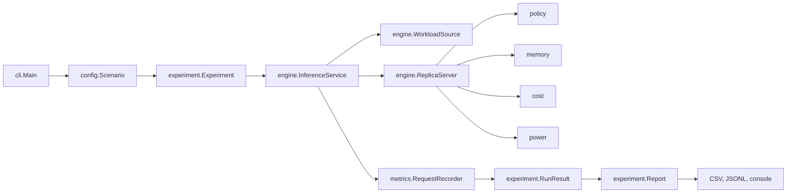
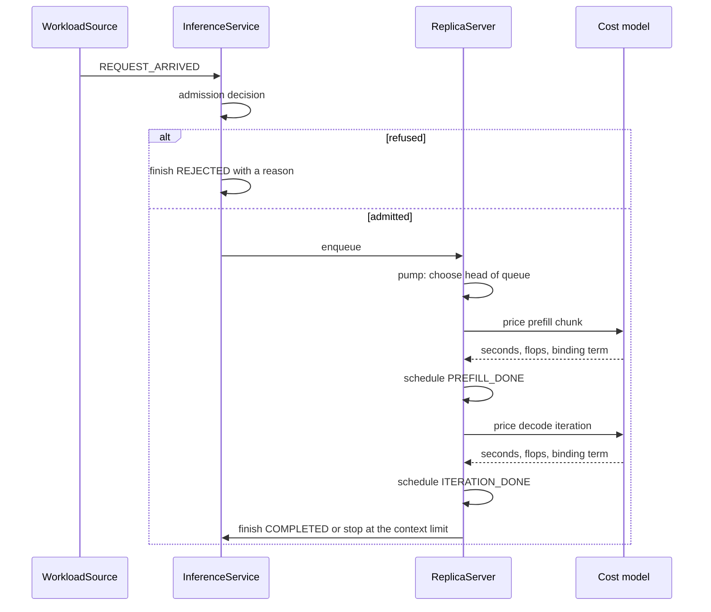
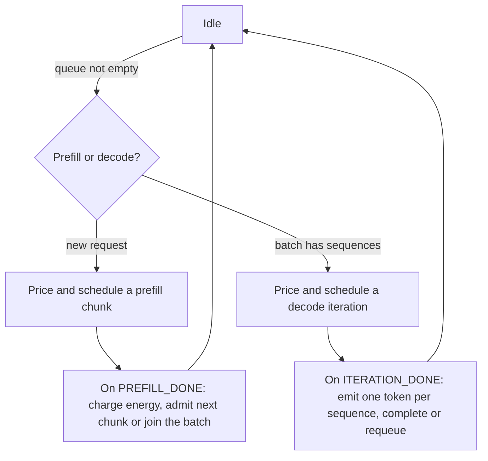
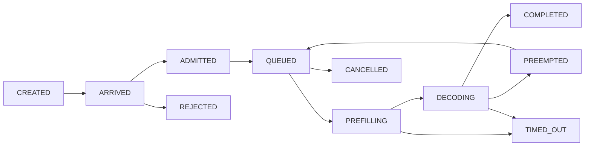

# Architecture

This page describes how a run is assembled, how a request moves through it, and why the same
scenario and seed produce the same numbers. It assumes you have read the [README](../README.md).

## The layers

| Package | Responsibility | Must not |
|---|---|---|
| `cli` | Parse arguments, apply overrides, map failures to exit codes | Build a scenario or touch metrics |
| `config` | Read properties, validate cross-cutting facts, build the object graph | Simulate anything |
| `domain` | Request, model, device, provenance, states, trace rows | Know about the engine |
| `engine` | Event entities: the service, the workload source, the replica loop | Read properties or write files |
| `policy` | Admission, routing and scheduling decisions over a load snapshot | Mutate engine or request state |
| `memory` | Split device memory, hand out and release blocks | Price a step |
| `cost` | Turn a step description into seconds, flops, bytes and a binding term | Reserve memory |
| `power` | Integrate idle and active intervals into joules | Decide when a step runs |
| `metrics` | Record rows, samples, percentiles and SLO counters | Change behaviour |
| `experiment` | Run repetitions, aggregate, write artifacts | Know how a step is priced |

The separation is checked by construction: `ReplicaServer` holds no execution formula of its own,
`policy` classes receive read-only snapshots, and `Report` only reads finished results.

## Building a run

1. `Main` reads the properties file as UTF-8, applies `-D`, `-s`, `-r` and `-o` overrides, and
   keeps the origin of every key.
2. `Scenario.load` builds the model, the device, the replicas, the workload and the cost model,
   validating each one and then the cross-cutting facts (the workload targets the served model,
   the device declares the model's precision, at least one replica exists, the trace is sorted by
   arrival).
3. `Main` asks the settings for keys nothing read and prints a warning for each. This happens
   after loading, because a key counts as read only when the loader touches it.
4. `Experiment` runs each repetition in a fresh `PureEdgeSim` engine with fresh entities.

A scenario that fails to load exits with code `3`. A run that fails an invariant exits with `4`.
A usage error exits with `2`.

## Entities and events

Three entity types participate:

- `WorkloadSource` schedules one `ARRIVE` event per request. It decides when a request arrives and
  what shape it has. It never learns whether the request is served, so the deployment cannot leak
  back into the traffic.
- `InferenceService` receives `REQUEST_ARRIVED`, applies admission and routing, and is the only
  place where a request is recorded as terminal. Funelling every outcome through one method is
  what makes "no request is lost and none is counted twice" checkable.
- `ReplicaServer` runs the device: it admits requests from its queue, executes prefill chunks and
  decode iterations one at a time, and charges energy over the intervals it occupies.

## The replica loop

A replica is a single server. One step executes at a time, and a step is either a prefill chunk or
one decode iteration, never both.

Details that matter for a result:

- **The cache decides the batch, not the scheduler.** A sequence that cannot reserve the block its
  next token needs is left out of the iteration. When every sequence is blocked, the replica
  suspends one according to `replica.victimOrder`, if preemption is enabled.
- **Preemption recomputes.** A suspended sequence loses its cache and returns to the queue. When it
  resumes, it is prefilled over the original prompt plus every token it had already produced, so
  the recomputation is charged in both flops and time.
- **An interrupted prefill keeps its chunks.** Chunks already written to the cache are not
  recomputed.
- **Chunked prefill costs more, not less.** Each chunk re-reads the weights, so a small chunk has a
  higher per-token cost than a large one; the benefit is that decodes are not starved.
- **Completion can stop early.** A generation that reaches the model or cache context limit before
  the requested number of tokens terminates with `CONTEXT_LIMIT_REACHED`, which is not a success.

## Request states

The transitions are declared in `RequestState`, and `InferenceRequest.transitionTo` rejects any
move that is not in the table. A request cannot be queued and decoding at once, and a terminal
state cannot be entered twice. Terminal states are `COMPLETED`, `REJECTED`, `TIMED_OUT` and
`CANCELLED`; the reason next to them is one of the `OutcomeReason` codes listed in
[metrics](metrics.md#outcomes).

## Time and energy accounting

Simulated time advances by scheduling the end of the current step. Between two steps the device is
idle. The replica integrates energy over the intervals it knows about:

- an active interval is charged at `device.activePowerWatts` and split across the sequences that
  occupied the device during it;
- an idle interval is charged at `device.idlePowerWatts` and attributed to the device, not to a
  request.

Because the split is exhaustive, the per-request energies sum to the active device energy within
rounding, and the device total is at least the idle floor. Both facts are asserted by the
invariant tests.

## Determinism

A repetition is a fresh engine with fresh entities. The order of operations inside
`Experiment.repetition` is part of the reproducibility contract:

1. seed the random generator;
2. name the repetition;
3. rebuild the workload plan with `WorkloadPlan.copyForRun()`;
4. create the entities.

Step 3 exists because a PureEdgeSim distribution binds the thread's generator when it is created.
Reusing a plan across repetitions would silently reuse the first repetition's sampler and make
later repetitions draw from a stream that no longer depends on their own seed.

Within a run, ties are broken deterministically: routing picks the lowest replica index, the
waiting queue falls back to arrival order, and the engine orders simultaneous events by insertion
sequence. The integration tests check that the same seed reproduces the same run and that a
different repetition salt produces a different one.

## Cost of a run

The simulator is cheap enough to sweep. A 30-second loaded scenario with three repetitions
completes in a few seconds of wall clock, including JVM start-up and artifact writing. The 19
configurations of the sweep driver, three repetitions each, take well under a minute in total.
That is the practical argument for a simulator over a hardware campaign: a parameter sweep fits in
a test run rather than in a separate project.

## Where to extend

| Goal | File | Contract |
|---|---|---|
| New admission rule | `policy/AdmissionPolicy` | Return `AdmissionDecision`; do not mutate state |
| New routing rule | `policy/RoutingPolicy` | Choose among the load snapshots; tie-break deterministically |
| New scheduling order | `policy/SchedulingPolicy` | Comparator over requests; declare whether it reads oracle lengths |
| New arrival pattern | `engine/WorkloadPlan` and `engine.WorkloadSource` | Validate its settings and describe itself for the artifacts |
| New execution model | `cost/ExecutionCostModel` | Name itself, declare provenance and calibration, return a `CostEstimate` |
| New reported quantity | `metrics/RequestRecorder`, `experiment/RunResult` | Add the header and the row in the same place, and an aggregate if it belongs in `summary.csv` |

A policy that reads the drawn output length instead of the prediction says so through
`usesOracleInformation()`, which is how a result can distinguish a deployable gain from an oracle
baseline.
