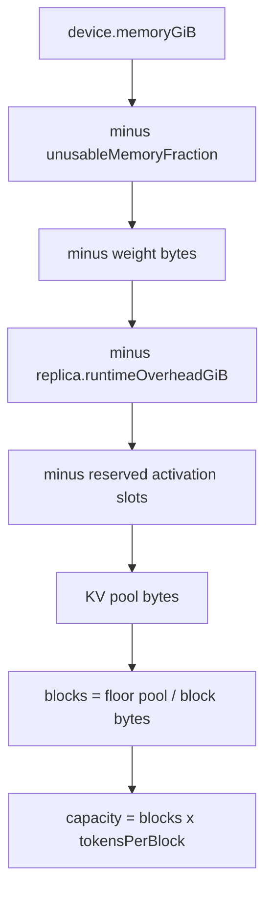
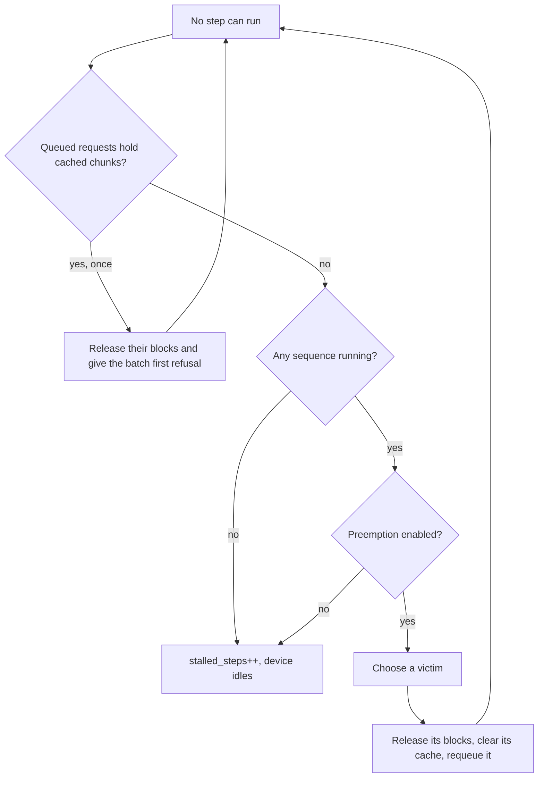

# Memory and caching

An LLM replica fails in a specific way: not by running out of flops, but by running out of memory
for the key-value cache. This page follows the memory from the device capacity to the blocks a
sequence holds, and describes what happens when a reservation is refused.

## From device capacity to a KV pool



The arithmetic:

```text
usable_bytes      = device.memoryGiB * 2^30 * (1 - unusableMemoryFraction)
weights           = parameterCount * bytesPerParameter
overhead          = replica.runtimeOverheadGiB * 2^30
activation_slots  = model.activationBytesPerSequence * replica.reservedActivationSlots
pool_bytes        = usable_bytes - weights - overhead - activation_slots
bytes_per_token   = 2 * layers * kvHeads * headDimension * kvBytesPerScalar
bytes_per_block   = bytes_per_token * replica.tokensPerBlock
total_blocks      = floor(pool_bytes / bytes_per_block)
capacity_tokens   = total_blocks * replica.tokensPerBlock
```

A pool that cannot hold even one block stops the load with an error naming the four deductions,
rather than starting a run that can admit nothing.

### Worked example

The loaded scenario:

```text
usable      = 24 * 2^30 * 0.95           = 24.48e9 bytes (22.8 GiB)
weights     = 7e9 * 2                    = 14.00e9 bytes (13.0 GiB)
overhead    = 0
slots       = 0
pool        = 10.48e9 bytes
bytes/token = 2 * 32 * 32 * 128 * 2      = 524,288 bytes (512 KiB)
block       = 524,288 * 16               = 8,388,608 bytes (8 MiB)
blocks      = floor(10.48e9 / 8.39e6)    = 1,249
capacity    = 1,249 * 16                 = 19,984 tokens
```

That is the `1249 blocks` the console prints for this scenario, and it is why a batch ceiling of 32
sequences is never reached: 32 concurrent sequences averaging 600 tokens already need more than
the cache holds.

The light scenario uses a 124 M model, so the weights cost only 248 MB and the same device has
41,082 blocks (657,312 tokens). Nothing queues there, and the cache never fills.

## Blocks and rounding

Memory is handed out in blocks, as paged-attention engines do. A reservation rounds up:

```text
blocks_for(tokens) = ceil(tokens / tokensPerBlock)
```

A sequence with 17 cached tokens and 16-token blocks holds two blocks. Rounding is visible in the
accounting: `allocated_blocks` in the request row is the rounded figure, and the pool's
`peak_occupancy` is blocks used over blocks total. A 16-token block with a 7 B model at fp16 costs
8 MiB, so the smallest rounding step is not negligible.

The pool only answers reservation questions. It does not choose a victim; that decision needs the
lifecycle state of the requests, so it belongs to the replica, under the configured order.

## Reservation points

There are three places where memory is asked for:

| Point | What is reserved | If refused |
|---|---|---|
| Prefill chunk | The tokens the chunk will cache | `cache_refusals++`, the request is suspended back to the queue, keeping its cached chunks until a stall releases them |
| Decode iteration, per sequence | One token by default, or the accepted-token window when speculative decoding is on, because each token the step may emit needs a slot | `cache_refusals++`, that sequence is left out of the iteration |
| Admission, `cache-capacity` policy | The predicted final context plus headroom | The request is rejected before any GPU work |

The first two are runtime refusals and are counted in `cache_refusals`. The third is an admission
decision and is counted as a rejection with reason `admission_no_cache_capacity`.

A queue head whose whole prompt cannot fit in the pool of any replica is rejected with
`prompt_exceeds_cache_capacity`. This is checked when the head is about to start, not at arrival:
the pool may have room later, but a prompt larger than the device can ever hold is hopeless at any
moment.

## What a full cache does

When no prefill chunk and no decode iteration can be scheduled, the replica tries to preempt:



The release at the stall is the escape from a pool held by suspended prefills. A suspended
prefill keeps the chunks it already cached, which is useful when it is rescheduled, but if enough
of them sit in the queue they can hold every block while the running batch needs one more block to
continue. Prefill cannot reserve, decode cannot progress, and preemption has no running victim.
Releasing the queued caches once, and letting the batch take the first refusal on the freed
blocks, keeps the pool live without changing the ordinary case; the regression test
`aTraceWhoseSuspendedPrefillsFillTheCacheStillCompletesEveryRequest` pins it.

A preempted sequence:

- loses every cached token, including the prompt it had already prefilled;
- keeps its generated tokens and its metrics;
- returns to `QUEUED` with a fresh queue-entry instant;
- is prefilled again when it is rescheduled, over the original prompt plus every token it produced,
  so the recomputation is charged in flops, time and energy;
- keeps its original arrival instant, so its TTFT includes both queue episodes.

An interrupted prefill is different: the chunks already written to the cache are kept, and the
request resumes from the last completed chunk.

## Victim orders

| Order | Victim | Rationale | Risk |
|---|---|---|---|
| `newest-first` | The sequence that started decoding last | Protects requests close to finishing | Can starve a long request that keeps being evicted |
| `lowest-priority` | The sequence with the lowest priority, then newest | Aligns eviction with the service class | Ignores remaining work |
| `longest-context` | The sequence holding the most blocks | Frees the most memory per eviction | Evicts the request that has done the most work |

All three break ties deterministically. None of them is a policy for a production engine; they are
the three orders that make the trade-off visible in a sweep.

## Which sequences enter an iteration

The batch is not simply the first `maxBatchSize` running sequences. Each sequence must reserve one
more token before it can join:

```text
for each running sequence, in order of starting decode:
    if batch is full: stop
    if the sequence can reserve one more token: add it
    else: cache_refusals++
```

If every sequence is blocked, the iteration cannot run and preemption starts. If some sequences can
run, the iteration runs with them, and the blocked ones wait for the next opportunity. This is why
the reported batch size can sit below both the batch ceiling and the number of running sequences in
the loaded scenario.

When `replica.speculativeDecoding=true`, the reservation is the accepted-token window rather than a
single token, because a verification step may emit several tokens per sequence at once. The window
is derived from `replica.draftTokens` and `replica.acceptanceRate`; with the mechanism off it is one,
so the reservation, the cost call and the emission reduce to the plain step described above.

## Opt-in prefix reuse

With `replica.prefixCache=true`, a request whose prompt matches one a completed request already
cached starts with those prompt tokens in place instead of recomputing them. The match is exact:
same model, same prompt length, and the same session when one is set. It is deliberately
conservative, so it never credits a hit the scenario cannot prove equal, which is the safe direction
for a published number.

Reuse changes the recomputation, not the accounting. The shared tokens are reserved in the pool
exactly as a recompute would reserve them, so `allocated_blocks` and `peak_cache_occupancy` reflect
the same blocks; what falls is the prefill flops, time and energy for the reused span. A request that
has already begun caching (a resumed or partially prefilled sequence) keeps its own progress and
takes no shortcut. The index of published prompts is bounded, dropping the oldest entry past a fixed
cap, so a long run cannot grow it without limit.

The mechanism is refused under prefill/decode disaggregation, where the prompt cache lives on a
different replica than the one that would reuse it. With it off, a prefill starts from zero cached
tokens exactly as it did before the mechanism existed.

## Counters and what they mean

| Counter | In `summary.csv` | Meaning |
|---|---|---|
| Cache refusals | `cache_refusals` | Reservations refused for lack of blocks, at prefill or decode |
| Preemptions | `preemptions` | Sequences suspended and requeued |
| Stalled steps | `stalled_steps` | Moments at which no step could be scheduled and the device idled |
| Peak batch | `peak_batch` | Largest decode batch, in sequences |
| Mean batch | `mean_batch` | Average decode batch over iterations |
| Peak cache occupancy | `peak_cache_occupancy` | Peak used blocks over total blocks, in `[0, 1]` |
| Capacity tokens | `replica` line | Blocks x tokens per block |

A high `peak_cache_occupancy` with many refusals is the signature of a cache-bound deployment. A
nonzero `stalled_steps` with preemption disabled means the device idled waiting for completions. A
nonzero `preemptions` means recomputation was paid and the batch is being kept alive by eviction.

## Consistency check

`ReplicaServer.checkCacheConsistency()` compares the blocks the pool says are handed out against
the blocks the requests say they hold, at the end of a repetition. The invariant tests call it, so
a bookkeeping change that leaks a block fails the build instead of showing up as a cache that
slowly shrinks.

The run-level invariants also require that no reservation exceeds the pool, that utilisation lies
in `[0, 1]`, and that per-request energy sums to the active device energy. Those three facts make
the memory story auditable from the artifacts alone.
