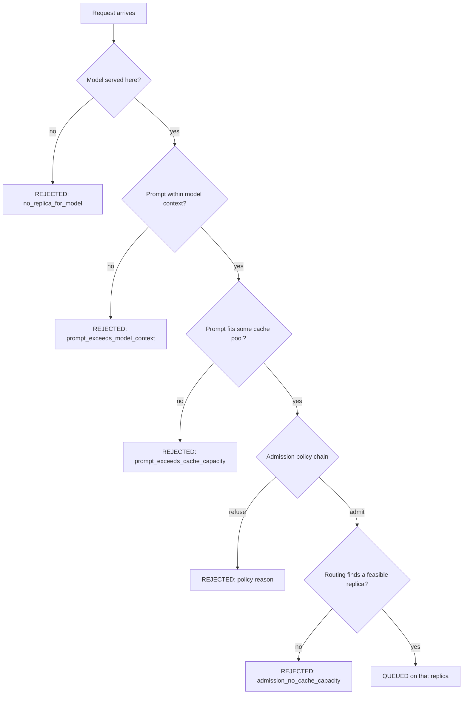

# Policies

Three decisions shape a run: whether a request enters the service (**admission**), which replica
receives it (**routing**), and which queued request starts next (**scheduling**). Each is a small
strategy class selected in the scenario file by name, or by fully qualified class name for a policy
that lives outside the engine, so a sweep can hold everything else fixed.

## Order of decisions



Two facts about this order are worth stating explicitly:

- The model, context and cache-capacity checks happen before admission and do not depend on the
  policy. Admission is about pressure, not about feasibility.
- Routing is cache-aware by construction. Every routing policy routes only among replicas that can
  hold the request's predicted final context. When none can, the request is rejected with
  `admission_no_cache_capacity`, even if no admission rule refused it.

## Admission

Admission receives the request, a load snapshot per replica and the clock. It returns an
`AdmissionDecision`: admitted, or refused with an `OutcomeReason`.

### `unlimited`

Always admits. This is the default and the right choice when the experiment is about what the
device does under pressure rather than about which requests a gateway would shed.

### `queue-limit`

```properties
policy.admission=queue-limit
policy.queueLimit.maxWaitingRequests=200
```

Refuses when the sum of waiting requests across replicas reaches the limit. The limit must be at
least 1, because a limit of 0 would refuse every arrival. The reason recorded is
`admission_queue_limit`.

This is the behaviour of a serving gateway with a bounded backlog: the queue is a shared resource,
so the count is summed over replicas rather than applied per replica.

### `cache-capacity`

```properties
policy.admission=cache-capacity
policy.cacheCapacity.headroomTokens=256
```

Refuses unless some replica currently has room for the request's predicted final context plus the
headroom. The headroom keeps room for the next decode steps, so an admitted request does not
immediately preempt someone else. The reason recorded is `admission_no_cache_capacity`.

The check reads the cache as it is now, not as it will be when the request starts. Waiting
requests free their cache when they finish, so the policy is conservative. Serving engines make
the same trade-off: they reserve for the predicted footprint rather than promise memory that other
sequences still occupy.

### `predicted-deadline`

```properties
policy.admission=predicted-deadline
policy.predictedDeadline.tolerance=0.1
```

Refuses when the least pending work of any replica exceeds the TTFT slack by more than the
tolerance:

```text
slack = ttft_deadline - clock
refuse when least_pending_work > slack * (1 + tolerance)
```

A request with no TTFT target is always admitted, because refusing it would invent a deadline the
workload never stated. The pending work is a lower bound on the wait: running sequences keep
decoding while the request waits, so the true wait is longer. A tolerance of 1 (the default) means
the policy refuses only when the predicted wait is more than twice the slack.

### Composing rules

```properties
policy.admission=queue-limit,cache-capacity,predicted-deadline
policy.queueLimit.maxWaitingRequests=200
policy.predictedDeadline.tolerance=0.1
```

Rules are applied in the written order, and the first refusal wins. The order changes the recorded
reason, not the verdict: a request that breaks two rules is refused either way, but the reason is
the one of the first rule that fired. The composite's description lists the chain, so
`config.txt` and the console show what was evaluated.

## Routing

Routing receives one read-only `ReplicaLoad` per replica and returns the chosen replica id, or `-1`
when no replica is feasible.

| Policy | Chooses | Tie-break |
|---|---|---|
| `round-robin` | The next feasible replica in identifier order | None; the cursor advances on every choice |
| `least-queued` | The feasible replica with the fewest waiting requests | Lowest identifier |
| `least-predicted-work` | The feasible replica with the smallest pending work in predicted seconds | Lowest identifier |

`least-predicted-work` inherits the provenance of the cost model, because the pending work is a
sum of its estimates. With an analytical cost model, those durations are as provisional as the
model itself, and `config.txt` says which model produced them.

`round-robin` resets its cursor before every repetition, so a run cannot inherit the position of
the previous one.

All three policies filter by feasibility first, so a deployment with uneven cache occupancy routes
around a full replica even under `round-robin`.

## Scheduling

Scheduling returns a comparator over the waiting queue. The engine sorts the queue when it reads
the head, not on every insertion, so the comparator must be consistent.

| Policy | Order | Reads |
|---|---|---|
| `fcfs` | Arrival instant, then request id | Nothing beyond arrival |
| `priority` | Priority descending, then arrival, then id | The priority declared by the workload |
| `shortest-expected-first` | Expected total tokens ascending, then arrival, then id | The predicted output length |
| `shortest-oracle-first` | Drawn total tokens ascending, then arrival, then id | The output length the workload sampled |

`shortest-expected-first` and `shortest-oracle-first` differ only in what they are allowed to see.
The first uses `predictedOutputTokens`, which is what an online estimator or a trace provides. The
second uses `outputTokens`, the value the workload actually drew, which no deployable controller
can know before the tokens are generated.

This distinction is reported: `SchedulingPolicy.usesOracleInformation()` is `true` only for
`shortest-oracle-first`. A result that improves under an oracle scheduler is a bound, not a gain,
and the flag is what lets a table say which one it is.

### Interaction with prediction mode

`workload.prediction` decides how the predicted length is produced:

| Prediction | `shortest-expected-first` sees |
|---|---|
| `oracle` | The drawn length, so expected and oracle coincide |
| `trace-observed` | The length recorded in the trace |
| `biased-factor` | The drawn length times a factor, systematically wrong by that factor |
| `constant` | A fixed number of tokens |

A run that uses `shortest-expected-first` together with `workload.prediction=oracle` is an oracle
run in everything but name. The artifact records both the prediction mode and whether the
scheduling policy claims oracle information, so the ambiguity is visible rather than argued about.

## Preemption

Preemption is configured in the replica, not in `policy.*`, because it happens inside one device:

```properties
replica.allowPreemption=true
replica.victimOrder=newest-first
```

See [memory](memory.md#victim-orders) for the three orders and their trade-offs. Admission and
preemption answer different questions: admission decides whether a request ever enters, preemption
decides which running request pays when the cache fills later.

## Writing a policy outside the engine

A policy does not have to live in the simulator. Implement the interface with a public no-argument
constructor, put the compiled class on the classpath of the run, and name it in the scenario:

```properties
policy.scheduling.class=com.example.MyScheduler
```

The three keys are `policy.admission.class`, `policy.routing.class` and `policy.scheduling.class`.
A class key wins over the matching name key, so a scenario can keep `policy.admission=queue-limit`
as the documented baseline and override it with `-D`:

```bash
java -cp "target/docket-1.0.1.jar:target/lib/*:my-policies" com.mechalikh.docket.cli.Main \
    -D policy.scheduling.class=com.example.MyScheduler scenarios/loaded-7b-memory-pressure.properties
```

On Windows the classpath separator is `;`. `mvn package` copies the runtime dependencies into
`target/lib`, and `examples/common.sh` builds the same classpath for the example scripts. The class
is loaded from the running JVM's classpath, so adding a directory next to the jar is enough, and no
change to the engine is needed. Each failure names the setting and the class, rather than surfacing
a stack trace from inside the simulator:

| Mistake | Message |
|---|---|
| Class not found | `The setting "policy.scheduling.class" names "…", which is not on the classpath; add the directory holding it to java -cp` |
| Wrong interface | `The setting "policy.scheduling.class" names "…", which does not implement SchedulingPolicy` |
| No no-arg constructor | `The class "…" named by "policy.scheduling.class" needs a public no-argument constructor` |

A custom admission policy replaces the whole chain, because `policy.admission.class` builds one
policy rather than a list; a chain can be written as a composite in the custom class.

The nine worked examples under [examples/](../examples/README.md) are the reference: each defines a
policy this way, pairs it with a built-in baseline on the same workload, runs both and reports the
measured difference. Their tests show the three error paths above and fix each policy's decision on
a hand-built load snapshot.

## Extending a policy

To add a policy to the engine itself, rather than externally:

1. Implement the interface (`AdmissionPolicy`, `RoutingPolicy` or `SchedulingPolicy`).
2. Give it a stable `name()`, a `describe()` that names its parameters, and a truthful
   `usesOracleInformation()`.
3. Add one `case` to the factory in `Scenario` and one clause to its error message, or expose it
   through a `.class` key like the ones above.
4. Add a unit test that fixes the decision on a hand-built load, and one integration run that shows
   the policy changes a known aggregate.

A policy must not mutate the request, the replica or the load snapshot. The snapshot is a value
copied at decision time; anything else would make the result depend on evaluation order.
