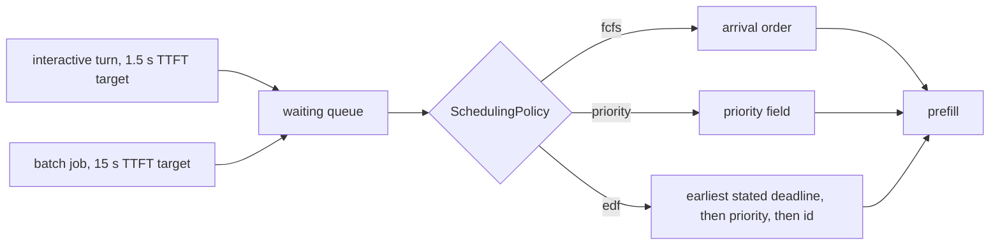

# Example 01: schedule by stated deadline, not by arrival

## Intention

One replica, one queue, two classes with different stated deadlines. The built-in first come,
first served order serves whoever arrived first, which is fine until interactive turns queue
behind batch work. This example writes a scheduling policy that orders the waiting queue by the
earliest deadline each request states, and compares it with the two built-in orders.

The question it answers: does reading the deadlines the clients sent change who meets their
service level, without changing the load?



## The policy

`src/main/java/com/mechalikh/docket/examples/edf/EarliestDeadlineFirst.java` implements
`SchedulingPolicy` in about thirty lines. The interesting part is the comparator:

```java
Comparator.comparingDouble(EarliestDeadlineFirst::earliestDeadline)
        .thenComparing(Comparator.comparingInt(InferenceRequest::getPriority).reversed())
        .thenComparingLong(InferenceRequest::getRequestId);
```

`earliestDeadline` is the earlier of the two instants the request states, its first-token deadline
and its end-to-end deadline, and `Double.MAX_VALUE` when it states neither, so an untimed request
waits last. The identifier is the final key, which makes the order total: two requests that tie on
deadline and priority still have one determined winner, and the replay is identical every time.
`usesOracleInformation()` returns `false` because the order reads only the targets the client sent,
never the output length the simulator drew.

A scheduling policy returns a comparator, so the same instance is used by every replica and it
keeps no state. Nothing to reset, nothing to leak between repetitions.

## The scenarios

All three scenarios replay `examples/data/sla-mix.csv`, 600 requests over 220 s on one replica:

- 184 interactive turns with a 1.5 s first-token target, a 15 s end-to-end target and 192 to 768
  prompt tokens;
- 416 batch jobs with a 15 s first-token target, a 300 s end-to-end target and 1,024 to 4,096
  prompt tokens.

They differ only in `policy.scheduling`:

| Scenario | Setting |
|---|---|
| `ex01-fcfs` | `policy.scheduling=fcfs` |
| `ex01-priority` | `policy.scheduling=priority` |
| `ex01-edf` | `policy.scheduling.class=com.mechalikh.docket.examples.edf.EarliestDeadlineFirst` |

The `class` key wins over the short name when both are present, so a scenario can name a class
without losing the readable fallback. `config.txt` in each results directory records which one
was used.

## Measured results

One repetition, seed 1, roofline-analytical cost model, synthetic 80 GiB accelerator. Attainment is
the share of requests that met every objective they stated.

| Scenario | Interactive TTFT attainment | Batch TTFT attainment | TTFT mean (s) | TTFT p95 (s) | E2E mean (s) | Energy (Wh) |
|---|---|---|---|---|---|---|
| `ex01-fcfs` | 27/184 = 0.147 | 385/416 = 0.925 | 8.245 | 15.22 | 17.60 | 37.65 |
| `ex01-priority` | 181/184 = 0.984 | 379/416 = 0.911 | 5.927 | 15.31 | 15.28 | 37.66 |
| `ex01-edf` | 177/184 = 0.962 | 381/416 = 0.916 | 5.941 | 15.10 | 15.30 | 37.66 |

What the table says:

- Arrival order is the wrong policy for mixed deadlines. `fcfs` completes all 600 requests and
  still misses the interactive target 157 times, because 27 interactive turns started within
  1.5 s. The device is busy 87% of the run; the problem is the order, not the capacity.
- Either deadline-aware order recovers almost all of it. `edf` raises interactive attainment by
  81.5 points and `priority` by 83.7, and both lower mean TTFT by about 2.3 s and mean end-to-end
  time by about 2.3 s.
- `priority` and `edf` land within 2.2 points of each other on interactive work and within half a
  point on batch work. In this mix the class label and the urgency agree: interactive requests
  also have the tightest deadline, so ordering by the field and ordering by the target produce
  almost the same queue. The difference is what the policy needs to know. `priority` trusts a
  label that someone assigned; `edf` reads the target the client stated.
- `edf` is marginally better for batch work (0.916 against 0.911) because the batch target is a
  real deadline in its order, whereas `priority` starves batch until no interactive request waits.

One further observation, from an exploratory run that is not a committed scenario: the deadline
order is only as good as the stated targets. Changing only the batch first-token target in the
trace from 15 s to 5 s, so that a batch job that has waited 4 s is more urgent than a fresh
interactive turn, drops interactive attainment in the `edf` scenario to 0.217 while batch stays at
0.231. That is what the targets asked for. A policy that follows stated deadlines cannot know that
one class would rather wait; it can only be given targets that express that.

## Running it

```bash
mvn -q test-compile
examples/01-sla-earliest-deadline-first/run.sh
```

The script runs the three scenarios in turn, prints the `mean over 1 repetition(s)` line of each
and leaves the artifacts under `results/ex01-fcfs`, `results/ex01-priority` and `results/ex01-edf`.

## Limits

- The workload, device and cost model are synthetic and uncalibrated. The comparison holds for the
  accounting Docket models and says nothing about a measured accelerator.
- One seed, one trace, one replica. The trace is committed and deterministic, so a second
  repetition would reproduce it exactly.
- The two classes cover a narrow range of targets. A mix where urgency and class labels disagree
  is the case `edf` is for, and the note above shows what happens when they do.
