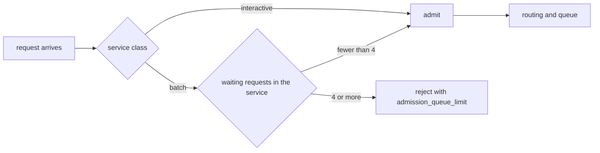

# Example 02: reserve the queue for the latency-sensitive class

## Intention

Example 01 changed the order of the queue. This one changes who is allowed into it. The built-in
`queue-limit` rule caps the whole service, so a burst of batch work fills the queue and the
interactive turns are refused along with it, which protects nothing. The policy here keeps the
queue short for everyone except the protected class: batch work may only wait while the service
holds fewer than four requests, and an interactive turn is always accepted.

The question it answers: can an admission rule hold the latency of one class without slowing the
other class more than necessary?



## The policy

`src/main/java/com/mechalikh/docket/examples/reservation/InteractiveReservationAdmission.java`
implements `AdmissionPolicy`. The whole decision is this:

```java
if (PROTECTED_CLASS.equals(request.getServiceClass()))
    return AdmissionDecision.admit();
int waiting = 0;
for (ReplicaLoad load : loads)
    waiting += load.waitingRequests();
return waiting >= limit ? AdmissionDecision.reject(OutcomeReason.ADMISSION_QUEUE_LIMIT)
        : AdmissionDecision.admit();
```

The decision is a pure function of the request and the loads the engine reports at that instant, so
it keeps no counter that could drift between repetitions. The limit is four by default and can be
set through the constructor, which is what the tests use. The name it writes to the artifacts is
`interactive-reservation`, and `config.txt` records it.

`OutcomeReason.ADMISSION_QUEUE_LIMIT` is the same reason code the built-in `queue-limit` rule uses,
because from the client's point of view the cause is the same: the service declined rather than
queue the request.

## The scenarios

Both replay `examples/data/sla-mix.csv` on one replica, as in example 01, and differ only in
admission:

| Scenario | Setting | Behaviour |
|---|---|---|
| `ex02-unlimited` | `policy.admission=unlimited` | everything is queued, however long the backlog grows |
| `ex02-reservation` | `policy.admission.class=...InteractiveReservationAdmission` | batch is refused once four requests wait |

## Measured results

One repetition, seed 1, synthetic 80 GiB accelerator, roofline-analytical cost model.

| Scenario | Completed | Refused | Interactive attainment | Batch attainment | Queueing mean (s) | TTFT mean (s) | TTFT p95 (s) | Energy (Wh) |
|---|---|---|---|---|---|---|---|---|
| `ex02-unlimited` | 600 | 0 | 27/184 = 0.147 | 385/416 = 0.925 | 8.203 | 8.245 | 15.22 | 37.65 |
| `ex02-reservation` | 555 | 45 | 175/184 = 0.951 | 371/416 = 0.892 | 0.283 | 0.324 | 1.33 | 34.90 |

What the table says:

- Holding four queue slots for interactivity moves interactive attainment from 0.147 to 0.951. The
  other 9 interactive turns are served but start after their 1.5 s target, which is what a queue of
  four batch jobs costs.
- The cost is 45 refused batch requests, all recorded as `admission_queue_limit`, and 3.3 points of
  batch attainment (0.925 to 0.892). Every batch request that was admitted still met its 300 s
  end-to-end target; the misses are all first-token targets.
- Mean queueing time falls from 8.2 s to 0.28 s and the overall TTFT p95 from 15.2 s to 1.33 s,
  because the queue can no longer grow behind batch work.
- The device is busy 80.2% of the run against 87.1% without the rule, and it draws 2.75 Wh less,
  both because 45 requests that would have run are never queued. Refusing work is not free
  throughput; here it buys 80 points of interactive attainment for 7.5 points of accepted load.

The limit is a knob, and where it sits is the decision this policy forces. Four was chosen by
running the same scenario with limits from 2 to 24: at 2 interactive attainment reaches 1.000 with
48 refusals, at 8 it falls to 0.674, and at 24 it is 0.163, within a point of unlimited.

## Running it

```bash
mvn -q test-compile
examples/02-sla-admission-protection/run.sh
```

## Limits

- The workload and device are synthetic and uncalibrated.
- The rule counts waiting requests, not their size. A queue of four 4,096-token prefills costs more
  than a queue of four short turns, so a production version would weigh the waiting work rather
  than the count. `ReplicaLoad.pendingWorkSeconds()` is available for that.
- The protected class is a constant in the source. A scenario that needs a configurable class or
  limit can use the constructor from a small wrapper class of its own.
- The refusal is final: a refused request is not retried later. A retry policy belongs at the
  client or gateway, outside the simulator's accounting.
