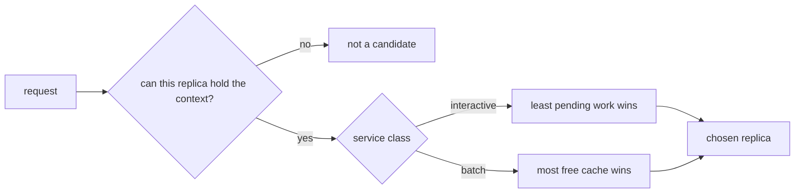

# Example 03: route each class towards the resource it is short of

## Intention

With one replica the only lever is the order of the queue. With four replicas there is a second
lever: which replica receives the request. The built-in `least-queued` policy counts requests in
each replica and picks the emptiest, which treats a 4,096-token batch prompt and a 256-token
interactive turn as one unit each.

This example writes a routing policy that reads the objective of each class instead. An
interactive turn goes to the replica that owes the least queued work, because its first token waits
for that work. A batch job goes to the replica with the most free cache, because a long prompt only
needs somewhere it fits.



## The policy

`src/main/java/com/mechalikh/docket/examples/fairshare/ClassObjectiveRouting.java` implements
`RoutingPolicy`. Three details matter more than the scoring:

- Candidates are filtered first through `feasibleCandidates`, the default method of the interface,
  which keeps only the replicas whose free cache can hold the context the request will reach. A
  replica that would refuse the request is never chosen, and if no replica can take it the policy
  returns `-1` and the service records the refusal.
- Equal scores fall back to the lowest replica identifier, so the choice is deterministic.
- The policy keeps no state between decisions. There is nothing to reset between repetitions.

## The scenarios

Both replay `examples/data/sla-mix-dense.csv` on four replicas: the same two-class mix as the first
two examples, offered in 80 s instead of 220 s, which saturates the deployment. 171 interactive
turns and 429 batch jobs. They differ only in routing:

| Scenario | Setting |
|---|---|
| `ex03-least-queued` | `policy.routing=least-queued` |
| `ex03-class-objective` | `policy.routing.class=com.mechalikh.docket.examples.fairshare.ClassObjectiveRouting` |

Admission is unlimited in both, so a request is only turned away when no replica can hold it. None
was.

## Measured results

One repetition, seed 1, four synthetic 80 GiB accelerators, roofline-analytical cost model.

| Scenario | Interactive attainment | Batch attainment | TTFT mean (s) | TTFT p95 (s) | TTFT p99 (s) | E2E mean (s) | Peak cache | Energy (Wh) |
|---|---|---|---|---|---|---|---|---|
| `ex03-least-queued` | 130/171 = 0.760 | 429/429 = 1.000 | 0.880 | 3.196 | 3.962 | 9.651 | 81.0% | 44.12 |
| `ex03-class-objective` | 156/171 = 0.912 | 429/429 = 1.000 | 0.938 | 4.842 | 7.819 | 9.625 | 76.6% | 44.19 |

What the table says:

- Interactive attainment rises by 15.2 points (0.760 to 0.912) with batch attainment unchanged at
  1.000. All 171 interactive turns are served in both runs; the difference is how many started
  within their 1.5 s target.
- The mean and the tail get slightly worse while the attainment gets better: mean TTFT moves from
  0.880 s to 0.938 s and p95 from 3.20 s to 4.84 s. Fewer interactive turns miss, but the ones that
  still wait wait longer, because the policy sends batch work to available cache rather than to a
  short queue, so a batch prefill can hold the device for longer when an interactive turn arrives.
  This is a real trade and the reason to quote attainment next to the tail, not instead of it.
- Peak cache falls from 81.0% to 76.6%. Spreading long prompts by free cache keeps the tightest
  replica from being the one that receives the next long prompt.
- Throughput and energy are effectively unchanged (3,708 tok/s and about 44.1 Wh in both runs).
  Routing moved the work between devices; it did not create capacity.

## Running it

```bash
mvn -q test-compile
examples/03-class-fair-share/run.sh
```

## Limits

- Synthetic, uncalibrated workload and devices, one seed.
- The policy is written for a two-class world with a latency class named `interactive`. The class
  whose objective is used is a constant in the source; the pattern to generalise it is the weighted
  score in example 05 or a switch on `request.getServiceClass()`.
- "Most free cache" is a proxy for "the long prompt fits and fits early". Once prefix caching is
  modelled, the better signal would be which replica already holds the prefix, which the simulator
  does not have.
