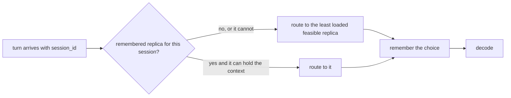

# Example 04: keep a conversation on one replica

## Intention

Every other routing example is a pure function: the decision depends only on the request and the
loads of the moment. A conversation is the case where that is not enough, because the useful
information is which replica served the previous turn. This example writes the smallest stateful
policy in the directory, and shows the two rules that come with keeping state: the memory must be
cleared before each repetition, and it must never override a replica that cannot take the request.

What the replay can measure here is not latency. Docket does not model shared-prefix reuse, so a
turn that returns to the previous replica reads no cached tokens and the run is not faster. What it
measures is where the turns land, which is the precondition for a prefix cache to matter.



## The policy

`src/main/java/com/mechalikh/docket/examples/affinity/SessionAffinityRouting.java` implements
`RoutingPolicy` with a `Map<String, Integer>` from session identifier to replica identifier:

```java
Integer remembered = session == null || session.isEmpty() ? null : affinity.get(session);
if (remembered != null && holds(candidates, remembered))
    chosen = remembered;
else
    chosen = leastLoaded(candidates).replicaId();
```

`holds` checks the remembered replica against the feasible candidates that
`feasibleCandidates` just filtered by cache, so affinity never sends a turn to a replica that would
refuse it. A request with no session is routed by load and is not remembered. `reset()` clears the
map, and the engine calls it before every repetition, so a run never inherits the routing of the one
before it.

## The workload

`examples/data/session-chats.csv` is 80 conversations of five turns each, 400 requests over 12.9 s,
replayed on four replicas. Each turn carries its session identifier, a prompt that grows by 128
tokens per turn up to 4,096, and the interactive targets of the other examples. Turns of one
conversation are 0.45 s to 0.95 s apart, which is about the time a turn itself takes, so the other
conversations interleave and a stateless policy really does scatter the turns.

| Scenario | Setting |
|---|---|
| `ex04-least-queued` | `policy.routing=least-queued` |
| `ex04-affinity` | `policy.routing.class=com.mechalikh.docket.examples.affinity.SessionAffinityRouting` |

## Measured results

One repetition, seed 1, four synthetic 80 GiB accelerators. "Turns" counts the 320 turns that have a
predecessor in their conversation; "same" counts those served by the replica of the previous turn.

| Scenario | Turns | Same replica | Share | Replicas per session | Interactive attainment | TTFT mean (s) | E2E mean (s) | Energy (Wh) |
|---|---|---|---|---|---|---|---|---|
| `ex04-least-queued` | 320 | 73 | 0.228 | 3.12 | 400/400 = 1.000 | 0.0205 | 0.668 | 11.10 |
| `ex04-affinity` | 320 | 320 | 1.000 | 1.00 | 400/400 = 1.000 | 0.0197 | 0.677 | 11.01 |

What the table says:

- Without affinity, the turns of one conversation spread over 3.1 replicas on average and only 22.8%
  of them return to the previous one. With affinity every turn does, and every conversation stays
  on one replica for its whole life.
- Neither policy misses an interactive target. Four replicas and 400 requests leave enough headroom
  that attainment is 1.000 either way, so this example deliberately says nothing about latency. The
  differences in mean TTFT (0.9 ms) and energy (0.8%) are the second-order effect of concentrating
  conversations on fewer replicas, not a claim.
- The value of the affinity is what it enables, not what it saves today: a prefix cache on the
  replica could serve the growing prompt of the next turn, and it can only do that if the turn
  arrives there. This repository has no such cache, and every page in it says so.

`run.sh` reads `rep01/requests.csv` to compute the locality before the per-request table is
discarded, so the two rows above can be rechecked from a local run:

```bash
examples/04-session-affinity/run.sh
```

prints

```text
run                      turns      same     share replicas/session
ex04-least-queued          320        73     0.228      3.12
ex04-affinity              320       320     1.000      1.00
```

## Running it

```bash
mvn -q test-compile
examples/04-session-affinity/run.sh
```

## Limits

- No shared-prefix reuse is modelled, so the policy cannot be credited with a cache saving. The
  locality is real; the benefit it would unlock is not measured here.
- Affinity wins by giving up load balancing across conversations. Here the deployment has slack; in
  the saturated scenarios of examples 03 and 05 the same map would push whole conversations onto
  busy replicas, and the least-loaded fallback only applies once a replica can no longer hold the
  context, not once it is merely slow. A production version would decay the memory or bound it.
- The map is unbounded. A long run with many sessions would keep one entry per conversation; the
  example is sized so that this is not the interesting part.
