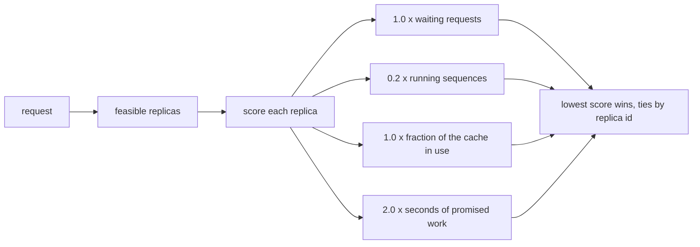

# Example 05: weigh several loads into one score

## Intention

`least-queued` counts requests: a waiting 4,096-token prefill weighs the same as a waiting 256-token
turn. This example replaces the count with a score over four loads, each with a weight, and routes
to the replica with the lowest score. The weights are the example: a reader changes four constants
and sees the routing move.

The question it answers: can a single weighted score over queue depth, batch size, cache use and
pending work beat the plain count, and what does it cost?



## The policy

`src/main/java/com/mechalikh/docket/examples/weighted/WeightedLoadRouting.java` implements
`RoutingPolicy`. The score is

```java
WAITING_WEIGHT * load.waitingRequests() + RUNNING_WEIGHT * load.runningSequences()
        + CACHE_WEIGHT * cacheUsed + PENDING_WEIGHT * load.pendingWorkSeconds();
```

with `WAITING_WEIGHT = 1.0`, `RUNNING_WEIGHT = 0.2`, `CACHE_WEIGHT = 1.0` and
`PENDING_WEIGHT = 2.0`. The terms are counts, a fraction of the cache and a number of seconds; the
weights turn them into one unitless score, so they are pure trade-offs. Lower is better and equal
scores fall back to the lowest replica identifier.

The constants were chosen in one regime and are not universal. Two facts about them are worth
knowing:

- Setting the last three weights to zero and leaving one point per waiting request reproduces
  `least-queued` exactly. During calibration that setting produced the identical run (interactive
  attainment 0.760, TTFT p95 3.196 s, 44.12 Wh), which is a good sanity check that the score is the
  built-in policy plus terms, not a different policy altogether.
- The pending-work term is the sensitive one. In the calibration sweep, with the cache weight held
  at 0.5, pending weights of 0.5, 1.0 and 2.0 gave interactive attainment 0.772, 0.766 and 0.719.
  Raising the cache weight from 0.5 to 1.0 recovered the 0.772 measured with the published
  constants.

## The scenarios

Both replay `examples/data/sla-mix-dense.csv` on four replicas, the saturated mix of example 03, and
differ only in routing:

| Scenario | Setting |
|---|---|
| `ex05-least-queued` | `policy.routing=least-queued` |
| `ex05-weighted` | `policy.routing.class=com.mechalikh.docket.examples.weighted.WeightedLoadRouting` |

## Measured results

One repetition, seed 1, four synthetic 80 GiB accelerators.

| Scenario | Interactive attainment | Batch attainment | TTFT mean (s) | TTFT p95 (s) | TTFT p99 (s) | E2E mean (s) | Peak cache | Energy (Wh) | Utilisation |
|---|---|---|---|---|---|---|---|---|---|
| `ex05-least-queued` | 130/171 = 0.760 | 429/429 = 1.000 | 0.880 | 3.196 | 3.962 | 9.651 | 81.0% | 44.12 | 68.7% |
| `ex05-weighted` | 132/171 = 0.772 | 429/429 = 1.000 | 0.899 | 3.087 | 3.751 | 9.668 | 77.7% | 44.36 | 69.1% |

What the table says:

- The gain is small and real. Two more interactive turns out of 171 meet their first-token target
  (0.760 to 0.772), the TTFT p95 falls by 0.11 s and the p99 by 0.21 s, while batch attainment stays
  at 1.000.
- Peak cache occupancy falls from 81.0% to 77.7%. The cache term keeps the fullest replica from
  receiving the next long prompt, which is the change that also explains the lower tail: a request
  that lands on a replica with room waits less for a block.
- Mean TTFT rises by 19 ms and energy by 0.24 Wh (0.5%). The score is not optimising mean latency;
  it is trading a slightly longer average wait for fewer long waits.
- Throughput is 3,708 tok/s in both runs. Four replicas at 69% utilisation leave routing little room:
  once the devices are saturated, where a request goes changes its queue but not the aggregate
  work. That is why the honest headline is a 1.2 point rise, not a step change.

The example is most useful read as a template: the four weights are declared as constants, the
score is a `public static` method, and `src/test` includes a unit test that fixes the arithmetic.
Changing the weights and re-running `run.sh` is the intended use.

## Running it

```bash
mvn -q test-compile
examples/05-weighted-load-routing/run.sh
```

## Limits

- Synthetic workload and devices, one seed.
- The weights were tuned on this one saturated mix. They are not a recommendation for another
  workload, and the calibration notes above show that two plausible alternative settings do worse.
- `pendingWorkSeconds()` is the engine's estimate of the queued work, not a measurement of future
  service time. It prices each waiting request at one prefill step plus its predicted decode
  iterations at the current batch size.
- The policy keeps no state, so it cannot learn weights from the run. Anything adaptive belongs
  outside the simulator's reproducibility contract.
