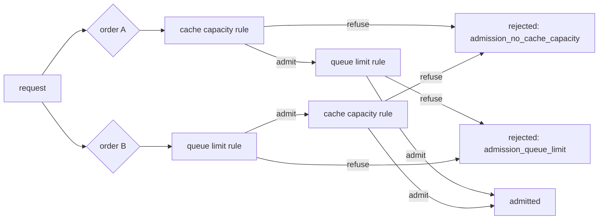

# Example 06: combine admission rules and read the refusals back

## Intention

A production admission layer rarely has one rule. It has a cache rule, a queue rule and perhaps a
deadline rule, and a request must pass all of them. This example combines two built-in rules and
compares the two possible orders, to answer a question the three scenarios make measurable: does
the order of admission rules change who is served, or only why a request was refused?



## The policy

No Java source is needed here: `CompositeAdmission` is built in and a scenario lists the rules in
evaluation order.

```properties
policy.admission=cache-capacity,queue-limit
policy.queueLimit.maxWaitingRequests=4
policy.cacheCapacity.headroomTokens=40000
```

`CompositeAdmission` evaluates the rules left to right and returns the first refusal. Each rule is
a pure function of the request and the loads, so a request that breaks two limits is refused either
way; the order decides only which rule gets to name the refusal. That property is stated in the
class Javadoc and pinned by a test, and the three scenarios are what make it visible in the
artifacts.

The settings were chosen so that both rules bite. `headroomTokens=40000` makes the cache rule
refuse when less than 40,000 tokens of cache remain, and `maxWaitingRequests=4` caps the queue. With
the queue cap at its default of 24 the cache rule alone would decide every refusal and the order
would not matter even for the reasons.

## The scenarios

All three replay `examples/data/sla-mix.csv` on one replica, with unlimited routing capacity:

| Scenario | `policy.admission` |
|---|---|
| `ex06-unlimited` | `unlimited` |
| `ex06-cache-then-queue` | `cache-capacity,queue-limit` |
| `ex06-queue-then-cache` | `queue-limit,cache-capacity` |

## Measured results

One repetition, seed 1, one synthetic 80 GiB accelerator.

| Scenario | Completed | `admission_no_cache_capacity` | `admission_queue_limit` | Interactive attainment | Batch attainment | TTFT p95 (s) | Energy (Wh) |
|---|---|---|---|---|---|---|---|
| `ex06-unlimited` | 600 | 0 | 0 | 27/184 = 0.147 | 385/416 = 0.925 | 15.22 | 37.65 |
| `ex06-cache-then-queue` | 550 | 46 | 4 | 178/184 = 0.967 | 371/416 = 0.892 | 0.690 | 34.63 |
| `ex06-queue-then-cache` | 550 | 41 | 9 | 178/184 = 0.967 | 371/416 = 0.892 | 0.690 | 34.63 |

What the table says:

- The two orders serve exactly the same 550 requests. Every throughput, latency and energy column
  is identical to the last digit, which is what a composite of pure rules must do.
- Only the refusal attribution differs. Checking the cache first records 46 cache refusals and 4
  queue refusals; checking the queue first records 41 and 9. The 5 requests that move are the ones
  that would have been refused by both rules, and the order decides which rule takes the blame.
- Both composites lift interactive attainment from 0.147 to 0.967 but cost 50 refused requests and
  3.3 points of batch attainment. That is the price of admission control, and it is the same price
  whether or not the order is right.
- The placement of the cache rule first is the defensible choice for diagnosis: a cache refusal
  tells the operator the pool was full, and checking it first keeps queue refusals limited to
  requests that would otherwise fit. The counts above are the evidence, not an assertion.

This is the pattern to reuse when a deployment has more than one limit: compose the rules, then
read `outcomes` in `summary.csv` or `outcome_reason` in `requests.csv` to see which limit actually
turned work away. A rule that never appears in the counts is a rule whose setting never binds, as
the queue rule was at 24 waiting requests.

## Running it

```bash
examples/06-composite-admission/run.sh
```

No `mvn test-compile` is needed for this example: it uses only built-in classes.

## Limits

- Synthetic workload and device, one seed.
- The composite needs at least one rule and applies all of them. There is no short-circuit on
  admission and no per-class composition; an example of that is a custom `AdmissionPolicy`, as in
  example 02.
- The reasons are recorded per request but the simulator does not model retries, so a refused
  request is gone. A gateway that retried elsewhere would change the numbers.
