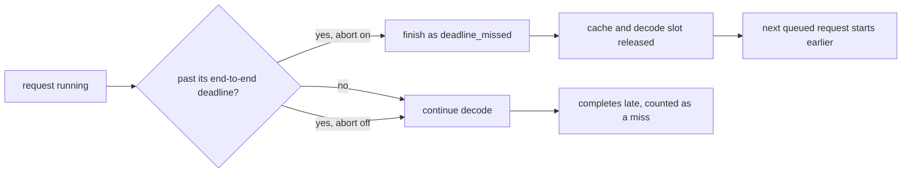

# Example 07: abort work that can no longer meet its deadline

## Intention

Examples 01 to 06 changed who is served and in what order. This one changes nothing about
admission, routing or scheduling: it flips one replica setting and asks what enforcing a deadline
is worth. With `replica.abortOnDeadlineMiss=true` a request that passes its end-to-end deadline is
stopped instead of being allowed to finish late.

The question it answers: if a request has already missed its target, what does finishing it cost,
and who pays?



## The setting

```properties
replica.allowPreemption=true
replica.victimOrder=newest-first
replica.abortOnDeadlineMiss=false
```

The two scenarios are identical apart from `replica.abortOnDeadlineMiss`:

| Scenario | Setting |
|---|---|
| `ex07-abort-off` | `replica.abortOnDeadlineMiss=false` |
| `ex07-abort-on` | `replica.abortOnDeadlineMiss=true` |

Both replay `examples/data/sla-mix.csv` on one replica. The interactive turns state a 15 s
end-to-end target; under this load a queue of batch work pushes some of them past it.

## Measured results

One repetition, seed 1, one synthetic 80 GiB accelerator.

| Scenario | Completed | `deadline_missed` | Interactive attainment | Batch attainment | TTFT mean (s) | TTFT p95 (s) | TTFT p99 (s) | Energy (Wh) |
|---|---|---|---|---|---|---|---|---|
| `ex07-abort-off` | 600 | 0 | 27/184 = 0.147 | 385/416 = 0.925 | 8.245 | 15.22 | 16.31 | 37.65 |
| `ex07-abort-on` | 569 | 31 | 27/184 = 0.147 | 405/416 = 0.974 | 8.096 | 14.50 | 15.26 | 37.55 |

What the table says:

- Thirty-one interactive turns pass their 15 s end-to-end target and are stopped, recorded as
  `timed_out:deadline_missed=31`. Without the setting they would have finished late and been counted
  as misses anyway: interactive attainment is 0.147 in both runs.
- Aborting cannot create an attainment that was already lost. What it creates is capacity. Batch
  first-token attainment rises from 0.925 to 0.974, five points, because the device stops spending
  decode iterations on work that cannot satisfy anyone.
- The tail of the completed requests shrinks slightly: TTFT p95 falls from 15.22 s to 14.50 s and
  p99 from 16.31 s to 15.26 s, since the slowest interactive requests no longer contribute a
  completion.
- Energy falls by 0.10 Wh (0.3%). Small, and honest: the run is only 220 s and the aborted work is
  5% of the requests. It would grow with the share of doomed work.
- End-to-end statistics of the completed stream do not improve (p95 30.43 s to 30.57 s), because
  batch jobs with their 300 s target dominate that tail. A policy that bounds the tail must bound
  the class it cares about; here that class was already bounded by the abort.

The setting is a statement about wasted work, not a scheduler. It is the cheapest way to make a
deployment stop paying for requests that are already late, and the table shows both the benefit and
its size.

## Running it

```bash
examples/07-deadline-abort/run.sh
```

No `mvn test-compile` is needed: the example is pure configuration.

## Limits

- Synthetic workload and device, one seed.
- The threshold is the end-to-end target the request states. With no target there is nothing to
  abort on.
- Aborting is not preemption: the request is finished, not requeued, and its client sees no answer.
  A deployment that wants to salvage work would need retries at a higher layer, which the simulator
  does not model.
- The 31 aborted turns are all interactive in this run. A different mix would move the count and the
  size of the benefit.
