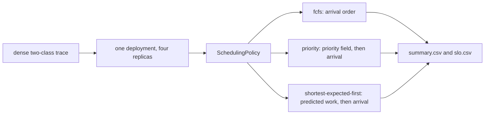

# Example 08: the same trace under the three built-in orders

## Intention

The earlier examples each add a policy. This one adds none: it runs one trace through the three
scheduling policies Docket ships, so the built-ins can be compared on the same work before any
custom policy is written. It is the baseline to read the other scheduling examples against.



## The policies

All three come from `policy.scheduling` and need no Java:

| Scenario | Setting | Order |
|---|---|---|
| `ex08-fcfs` | `policy.scheduling=fcfs` | arrival instant, then request identifier |
| `ex08-priority` | `policy.scheduling=priority` | higher priority first, then arrival, then identifier |
| `ex08-shortest-expected-first` | `policy.scheduling=shortest-expected-first` | smallest predicted output first, then arrival, then identifier |

`shortest-expected-first` reads `predictedOutputTokens`, the length a controller can estimate
before the request runs, so `usesOracleInformation()` is `false` and the artifacts do not label it an
upper bound. The oracle variant, `shortest-oracle-first`, reads the length the simulator drew and is
labelled `[oracle]`; it is deliberately not part of this comparison.

`ex08-*` scenarios replay `examples/data/sla-mix-dense.csv` on four replicas, the saturated mix
used by examples 03 and 05: 171 interactive turns with a 1.5 s first-token target and 429 batch
jobs with a 15 s first-token and 300 s end-to-end target, in 80 s.

## Measured results

One repetition, seed 1, four synthetic 80 GiB accelerators. All three runs complete all 600
requests.

| Scenario | Interactive attainment | Batch attainment | TTFT mean (s) | TTFT p50 (s) | TTFT p95 (s) | TTFT p99 (s) | E2E mean (s) | Energy (Wh) |
|---|---|---|---|---|---|---|---|---|
| `ex08-fcfs` | 130/171 = 0.760 | 429/429 = 1.000 | 0.880 | 0.090 | 3.196 | 3.962 | 9.651 | 44.12 |
| `ex08-priority` | 170/171 = 0.994 | 429/429 = 1.000 | 0.716 | 0.088 | 3.043 | 3.736 | 9.498 | 44.17 |
| `ex08-shortest-expected-first` | 171/171 = 1.000 | 427/429 = 0.995 | 0.597 | 0.086 | 2.136 | 12.16 | 9.302 | 44.39 |

What the table says:

- Arrival order is the weakest of the three for interactive work: 41 interactive turns miss their
  1.5 s target against 1 for `priority` and none for `shortest-expected-first`.
- `shortest-expected-first` gets the best interactive result by serving short jobs first, and it is
  the only one that costs batch work: 2 batch jobs miss their 15 s target and the batch TTFT p99
  jumps to 12.16 s. A long batch job that arrives early waits while short work keeps overtaking it,
  until its own target is near. This is the classic shortest-job-first trade, visible in the p99
  rather than the mean, and it is why the mean is a bad sole summary of a scheduling policy.
- `priority` is close to `shortest-expected-first` on interactive attainment (0.994 against 1.000)
  without the batch tail, because the class label already encodes which work is urgent. It relies on
  the label being right, which is the point example 01 makes about deadline order.
- Energy differs by 0.6% across the three, and throughput is 3,708 tok/s in all of them. Scheduling
  moves latency between requests; it does not change how much work the devices do.

The three scenarios differ only in one line each. A sweep over policies is a sweep over scenario
files, and `scripts/run_sweeps.sh` in the repository root generalises the pattern.

## Running it

```bash
examples/08-policy-sweep/run.sh
```

## Limits

- Synthetic workload and devices, one seed, one mix.
- The three policies are the shipped ones. `shortest-oracle-first` and the custom orders of
  examples 01 and 09 are compared on other traces in their own pages.
- `priority` reads a field nothing in the workload enforces as a policy; the trace sets it per
  class. A deployment where clients choose their own priority has a different problem, and the
  simulator does not model it.
