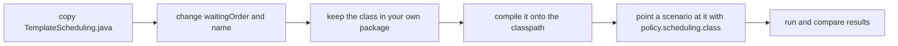

# Example 09: a template to start a scheduling policy from

## Intention

Examples 01, 02, 03, 04 and 05 each make a point about a policy. This one is the file a reader
copies when the point is their own. It is a complete scheduling policy, written out by hand, that
reproduces the built-in first come, first served order and nothing more. What it teaches is the four
places a policy has to get right, which are the same four whether the order is trivial or not.



## The policy

`src/main/java/com/mechalikh/docket/examples/template/TemplateScheduling.java` is forty lines, most
of them Javadoc. The order is:

```java
Comparator.comparingDouble(InferenceRequest::getTime)
        .thenComparingLong(InferenceRequest::getRequestId);
```

The four contract points the class documents:

1. The order is total. The identifier is the last key, so two requests that tie on every other key
   still have one determined winner. Without it, the order of equal keys would depend on the
   internal layout of the queue and the same configuration would not replay the same way.
2. The policy is a pure function of the requests it is given. No counters, no clock, no randomness,
   so nothing has to be reset between repetitions.
3. `usesOracleInformation()` answers honestly. Returning `true` labels the policy and its runs as an
   upper bound in the artifacts, because a simulated policy can read a length no production
   controller has.
4. The class has a public no-argument constructor, because the scenario names it and the loader
   instantiates it reflectively.

## Loading it from a scenario

```properties
policy.scheduling.class=com.mechalikh.docket.examples.template.TemplateScheduling
```

The `policy.<kind>.class` key takes precedence over the short name for admission, routing and
scheduling alike. The class is loaded with `Class.forName`, checked for the right interface and
instantiated through a public no-argument constructor; a missing class, a wrong interface or a
missing constructor each produce an error naming the setting that failed. A user's own class works
the same way as long as the directory holding it is on the classpath.

The example sources under `examples/*/src` are compiled into `target/test-classes` by
`build-helper-maven-plugin` during `mvn test-compile`, which is how they are on the classpath
without entering the published jar. A policy kept outside the repository can be added with
`-cp` to the `java` command instead.

## The scenario and its result

`ex09-template` replays `examples/data/sla-mix.csv` on one replica, with the same settings as
`ex01-fcfs`:

| Scenario | Setting |
|---|---|
| `ex09-template` | `policy.scheduling.class=...TemplateScheduling` |
| `ex01-fcfs` (other example) | `policy.scheduling=fcfs` |

The template is not a better policy, and the replay does not pretend otherwise:

| Scenario | Completed | Interactive attainment | Batch attainment | TTFT mean (s) | TTFT p95 (s) | Energy (Wh) |
|---|---|---|---|---|---|---|
| `ex09-template` | 600 | 27/184 = 0.147 | 385/416 = 0.925 | 8.245 | 15.22 | 37.65 |

Those are the numbers of `ex01-fcfs` to the last digit, and the test
`theTemplatePolicyReproducesTheBuiltInFirstComeFirstServedOrder` asserts it against the whole
per-request table, not only the summary. That equality is the point: a hand-written policy that
claims to be first come, first served has to produce the built-in run exactly, or the difference is
a bug in the hand-written file.

## Running it

```bash
mvn -q test-compile
examples/09-custom-policy-template/run.sh
```

## Limits

- The template copies a built-in order, so it demonstrates the contract, not a policy idea. For
  ideas, start from examples 01, 02, 03 or 04 and keep the four contract points.
- The loader requires a public no-argument constructor, so a policy with tunable parameters needs
  defaults in that constructor or a subclass that supplies them. The examples use constants for the
  same reason.
- A scheduling policy cannot see the queue, the clock or the replicas, only the requests it is asked
  to order. A policy that needs more, such as one that ages requests against wall-clock time, must
  read it from the requests themselves or wait for an interface that passes it.
