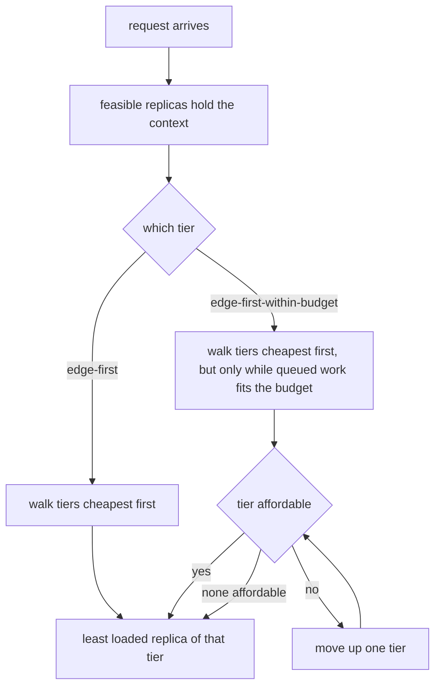

# Example 10: place requests by device tier, not by load alone

## Intention

A fleet that mixes a mobile accelerator, an on-premise server and a cloud card has a preference no
load counter can see. The operator may want the edge used because its own clients are closest,
because the prompt may not leave the site, or because a 15 W device is cheaper to run than a 300 W
one. The built-in balancers treat every replica as interchangeable, which is right for a fleet of
clones and wrong for a fleet of unlike machines.

This example makes the preference explicit and then prices it. Three placement rules run on one
heterogeneous fleet under identical traffic:

- `least-queued` and `least-predicted-work`, the built-in balancers, chosen as the reference a load
  counter would give;
- `edge-first`, a policy that always sends a request to the cheapest tier that can hold it;
- `edge-first-within-budget`, the same preference, released upward as soon as the queue on the
  cheaper tier would make the request miss its first-token target.

The question it answers: what does an edge preference cost the requests that wait for it, and can a
stated first-token budget recover most of that cost while still keeping a large share of the traffic
on the edge?



## The fleet

Four replicas serve one synthetic 1B decoder across three device families, each an order of
magnitude apart on both axes the roofline reads. Every number in the scenarios is synthetic; the
artifacts repeat this as `cost_provenance=synthetic`, and the results should be read as a comparison
of placement rules under a known spread of service times, never as a prediction about hardware.

| Profile | Family (`device.<profile>.type`) | Memory | Bandwidth | fp16 TFLOPS | Idle / active W | Batch ceiling |
|---|---|---|---|---|---|---|
| `nano` (2 replicas) | `edge-device` | 8 GiB | 68 GB/s | 2 | 4 / 15 | 2 |
| `server` (1 replica) | `edge-datacenter` | 24 GiB | 700 GB/s | 100 | 20 / 300 | 32 |
| `cloud` (1 replica) | `cloud-accelerator` | 80 GiB | 3350 GB/s | 700 | 50 / 700 | 64 |

The batch ceiling is written per profile, because it is a property of the machine: a phone-class
device holds two sequences while a cloud card holds a batch. Traffic is a Poisson chat mix at 60
requests per minute, short prompts and short answers, and every request states the same first-token
target of 2 seconds so the budget guard has something to work with. Three repetitions, seed 1.

## The two policies

`src/main/java/com/mechalikh/docket/examples/edgefirst/EdgeFirstRouting.java` walks the tier order
`edge-device > edge-datacenter > cloud-accelerator` and, inside the first tier that has a feasible
replica, picks the one with the fewest requests already inside (ties broken by replica id). A replica
whose family is not listed is treated as the most expensive machine there is and placed after every
listed tier, so an unknown device never steals traffic from a tier the operator named.

`EdgeFirstWithinBudgetRouting.java` extends it and asks one more question of each candidate: does the
work already promised to that replica's queue (`pendingWorkSeconds()`) fit inside the request's
first-token budget? If it does, the request goes there and the cheaper tiers win as often as they
can. If it does not, the request moves up one tier. A request that states no budget is placed exactly
as the unguarded policy would, so the comparison is only about the traffic that carries a target, and
a request no candidate can serve in time goes to the least busy machine, which is the cheapest way to
miss.

## Measured results

One fleet, one workload, three repetitions, seed 1. Latency and energy are pooled over the
repetitions; goodput and the SLO column count a request only when it meets every stated objective.

| Scenario | Goodput | Interactive SLO met | TTFT mean (s) | TTFT p95 (s) | TTFT p99 (s) | E2E mean (s) | Peak device util | Energy (Wh) |
|---|---|---|---|---|---|---|---|---|
| `least-queued` | 0.991 | 0.991 | 0.224 | 0.734 | 1.018 | 2.084 | 12.6% | 8.84 |
| `least-predicted-work` | 0.993 | 0.993 | 0.167 | 0.609 | 0.760 | 1.713 | 14.6% | 9.21 |
| `edge-first` | 0.208 | 0.200 | 6.579 | 14.648 | 20.563 | 10.273 | 99.3% (edge) | 6.63 |
| `edge-first-within-budget` | 0.993 | 0.993 | 0.169 | 0.609 | 0.780 | 1.773 | 15.6% | 9.14 |

Where the requests actually landed, read from the per-request table by `tier_placement.py`:

```
scenario                    edge-device    edge-datacenter    cloud-accelerator    mean TTFT on edge
least-queued                    51.7%             38.8%               9.5%              0.428 s
least-predicted-work            43.1%             44.2%              12.7%              0.379 s
edge-first                     100.0%              0.0%               0.0%              6.579 s
edge-first-within-budget        43.1%             56.9%               0.0%              0.382 s
```

What the two tables say together:

- The pure preference is expensive. `edge-first` puts every request on the two `nano` devices and
  leaves the server and the cloud card completely idle (0.0% utilisation). Those two 15 W machines
  saturate at 99%, the mean first-token time rises from about 0.2 s to 6.6 s, and interactive goodput
  collapses to 0.208. Nearly every request still completes (96.6% success), but almost none meets its
  2 second target. The preference bought locality at the cost of the service level.
- The same preference is also the cheapest in energy: 6.63 Wh, below every balancer, because two
  power-cheap edge devices doing all the work beat a fleet that keeps running 300 W and 700 W
  machines. This is the honest tension the example is about, and it does not disappear when the
  budget guard is added.
- The budget guard recovers almost all of it. `edge-first-within-budget` keeps 43.1% of the traffic on
  the edge, exactly the share the load-based `least-predicted-work` happens to pick, yet goodput returns
  to 0.993 and mean TTFT to 0.169 s, indistinguishable from the reference balancers. When the edge queue
  would bust a request's target, it spills one tier up, and because the datacenter tier is fast it can
  absorb the whole spill without ever reaching the cloud card (0.0% placed on cloud).
- The guard pays a little energy back. At 9.14 Wh it sits with the balancers, not with the pure
  preference, because honouring the budget means actually using the server. So the choice the example
  exposes is genuine: a fixed edge preference buys locality and energy and sacrifices latency, while a
  budget-guarded preference buys latency and keeps the edge share, and gives back the energy saving.

Read this against example 05, where routing gains were small because the replicas were clones: the
effect here is large precisely because the machines are not interchangeable, and the policy is free to
prefer one family over another.

## Running it

```bash
mvn -q test-compile
examples/10-edge-first-placement/run.sh
```

The script runs the four scenarios into `results/`, prints the `mean over` line of each, and runs
`tier_placement.py`, which reports the per-tier share and edge TTFT above from the per-request tables
before they are dropped. The placement test lives in `src/test/java/com/mechalikh/docket/examples/EdgeFirstRoutingTest.java`
and fixes the tier order, the within-tier choice, the unlisted-tier fallback and the budget guard.

## Limits

- Synthetic model, devices and workload, one seed. The three families are chosen an order of
  magnitude apart to make the tier decision visible, not to match real cards.
- The budget guard reads the queue's promised work, not the request's own prefill, because a routing
  policy holds no cost model. A short queue on a slow device can still look affordable, which is why
  the guard's edge TTFT (0.382 s) is measured over the whole run rather than guaranteed per request.
- The policy keeps no state, so it cannot learn the tier order from the run. The order is declared
  here and read by `ReplicaLoad.tier()`, which is the value `device.<profile>.type` gives each machine.
- One fleet, no access link. This example is about placement across tiers that already see the request;
  the cost of the hop from the client to the site is a separate mechanism.
