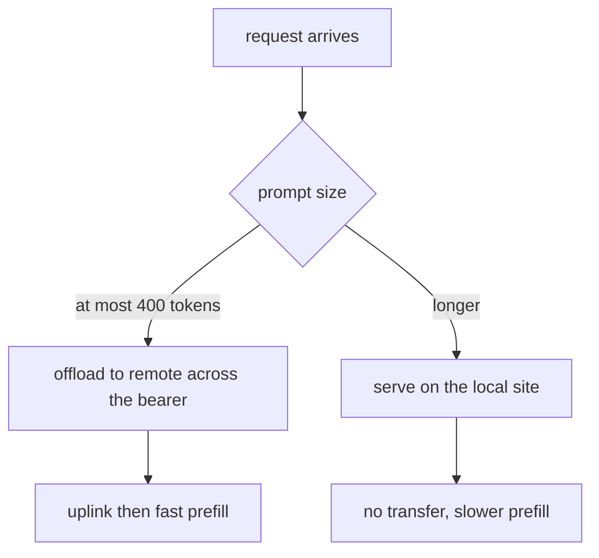

# Example 11: offload across a bearer only when the prompt is short

## Intention

A remote accelerator answers in a fraction of the time a local machine takes, but the request has to
cross the access link before the remote can even start. For a short prompt the transfer is almost
free and the speed wins; for a long prompt the bytes on the wire cost more than the compute saved.
A load balancer cannot see this, because the load snapshot it reads has no notion of the bearer, so it
offloads the wrong requests and the client waits for the prompt to arrive.

This example measures what a bearer-aware placement rule is worth, and shows that the honest answer
depends entirely on how fat the bearer is. Four scenarios cross two placement rules with two links:

- the built-in `least-predicted-work`, a capacity-blind balancer that offloads whatever the remote
  makes look cheap;
- a custom `offload-small-prompts` rule that sends a request to the remote only while its prompt is
  short enough to cross quickly;

over a narrow bearer (50 kbps, 150 ms one way) and a fat one (100 Mbps, 5 ms).

The question it answers: is offloading *more* requests better or worse than offloading the *right*
ones, and does the difference survive a fast bearer?



## The fleet

Two replicas, one per machine, so the only thing that decides where a request goes is the policy. All
figures are synthetic and every artifact row repeats `cost_provenance=synthetic`.

| Profile | Family | Memory | fp16 TFLOPS | Idle / active W | Access bearer |
|---|---|---|---|---|---|
| `onsite` | `edge-datacenter` | 24 GiB | 40 | 20 / 250 | none (same site) |
| `remote` | `cloud-accelerator` | 80 GiB | 700 | 50 / 700 | `wan` |

Traffic is a low-rate Poisson chat mix (20 requests per minute) whose prompts straddle the 400-token
threshold, so neither machine saturates and the difference that shows up is the link, not the queue.
Every request states a 0.5 second first-token target. Three repetitions, seed 1.

A text prompt is only kilobytes (four bytes per token here), so its transfer is invisible on a fat
link and decisive on a narrow one: at 50 kbps a 1,200-token prompt (4.8 KB) takes 0.77 s to cross,
which alone busts the 0.5 s target. That is the regime where placement matters, and the fat-bearer
scenarios are the control that shows the effect is the bearer and not the policy.

## The policy

`src/main/java/com/mechalikh/docket/examples/offload/OffloadByPromptSizeRouting.java` reads
`request.getInputTokens()` and `ReplicaLoad.tier()`. A prompt of at most `PROMPT_LIMIT` (400) tokens
prefers the `cloud-accelerator` tier; a longer one prefers `edge-datacenter`; within the preferred
tier it takes the least loaded replica, and if the preferred tier has no feasible replica it falls
back to the other one. The threshold is a hand-set proxy for the bearer tax, not a model of it: a
routing policy holds neither the link's capacity nor its latency, so the reader sets the constant
against the link they write in the scenario. `Integer.MAX_VALUE` offloads everything, `-1` offloads
nothing.

## Measured results

Pooled over the three repetitions. The placement split, the uplink each cohort pays and the latency it
sees come from `offload_savings.py`, read from the per-request tables.

On the narrow bearer:

| Scenario | Goodput | TTFT mean (s) | TTFT p95 (s) | TTFT p99 (s) | Offloaded share | Uplink on offloaded | TTFT kept local | Energy (Wh) |
|---|---|---|---|---|---|---|---|---|
| `least-predicted-work` | 0.897 | 0.124 | 0.632 | 0.810 | 20.6% | 0.509 | 0.024 | 7.89 |
| `offload-small-prompts` | 0.992 | 0.168 | 0.393 | 0.406 | 46.1% | 0.324 | 0.034 | 7.41 |

On the fat bearer:

| Scenario | Goodput | TTFT mean (s) | TTFT p95 (s) | TTFT p99 (s) | Offloaded share | Uplink on offloaded | TTFT kept local | Energy (Wh) |
|---|---|---|---|---|---|---|---|---|
| `least-predicted-work` | 0.996 | 0.021 | 0.044 | 0.055 | 20.6% | 0.005 | 0.024 | 7.87 |
| `offload-small-prompts` | 0.996 | 0.021 | 0.048 | 0.056 | 46.1% | 0.005 | 0.034 | 7.39 |

What the two tables say:

- On a narrow bearer the balancer offloads the wrong requests. It sends only 20.6% of them to the
  remote, but those are chosen by predicted work rather than by prompt size, so they are the medium and
  long prompts, and their mean uplink of 0.509 s lands right on the 0.5 s target. A large slice of them
  miss, goodput falls to 0.897, and the tail stretches (p95 0.632, p99 0.810 s).
- The prompt-size rule offloads more than twice as many requests (46.1% against 20.6%) and wins anyway
  (goodput 0.992), because it chooses which. Short prompts cross (uplink 0.324 s, still under target),
  long prompts stay on the wire-free local machine (0.034 s). It pays a little mean latency (0.168
  against 0.124 s, because long prompts are now served by the slower machine) to halve the tail (p99
  0.406 against 0.810 s) and lift goodput by 0.095. This is the whole point: it is not how much you
  offload, it is what you offload.
- On a fat bearer the distinction vanishes. The transfer is about 5 ms, so both rules reach 0.996
  goodput and 0.021 s mean TTFT. The bearer-aware rule is not needed, yet it costs nothing here: it
  still keeps the long prompts local, which nudges energy from 7.87 to 7.39 Wh and leaves the remote to
  idle. The reader who has a fat link should not carry the extra rule; the reader who has a thin one
  cannot afford to leave it out.
- The energy saving is small and comes from the same asymmetry: a 250 W local machine finishing a long
  prompt costs less than a 700 W remote finishing the same compute after the prompt crossed the wire,
  so keeping the long prompts local is cheaper even though it is slower per token.

## Running it

```bash
mvn -q test-compile
examples/11-access-link-offloading/run.sh
```

The script runs the four scenarios into `results/`, prints the `mean over` line of each, and runs
`offload_savings.py`, which reports the offloaded share, the uplink each cohort pays and the latency it
sees from the per-request tables before they are dropped. The decision logic is pinned in
`src/test/java/com/mechalikh/docket/examples/OffloadByPromptSizeRoutingTest.java`.

## Limits

- Synthetic model, devices, workload and bearer, one seed. The narrow bearer is the constraint that
  makes the effect measurable; a real access link for text is usually fat enough that one-hop transfer
  is negligible, which is exactly what the fat-bearer control shows.
- The threshold is a fixed proxy for the bearer tax, not an estimate of it. The policy does not read
  `link.<name>.capacityMbps`; the example fixes the crossover and the reader matches it to their link.
  A production policy would need the link in the load view to do better than a constant.
- The rule uses `request.getInputTokens()`, the prompt length, which the client knows at release time,
  so the decision needs no future information.
- One replica per machine and a low arrival rate, so queueing never dominates and the only lever is the
  bearer. Congestion on the bearer itself (transfers queuing behind each other) is modelled by the link
  but not exercised at this rate.
