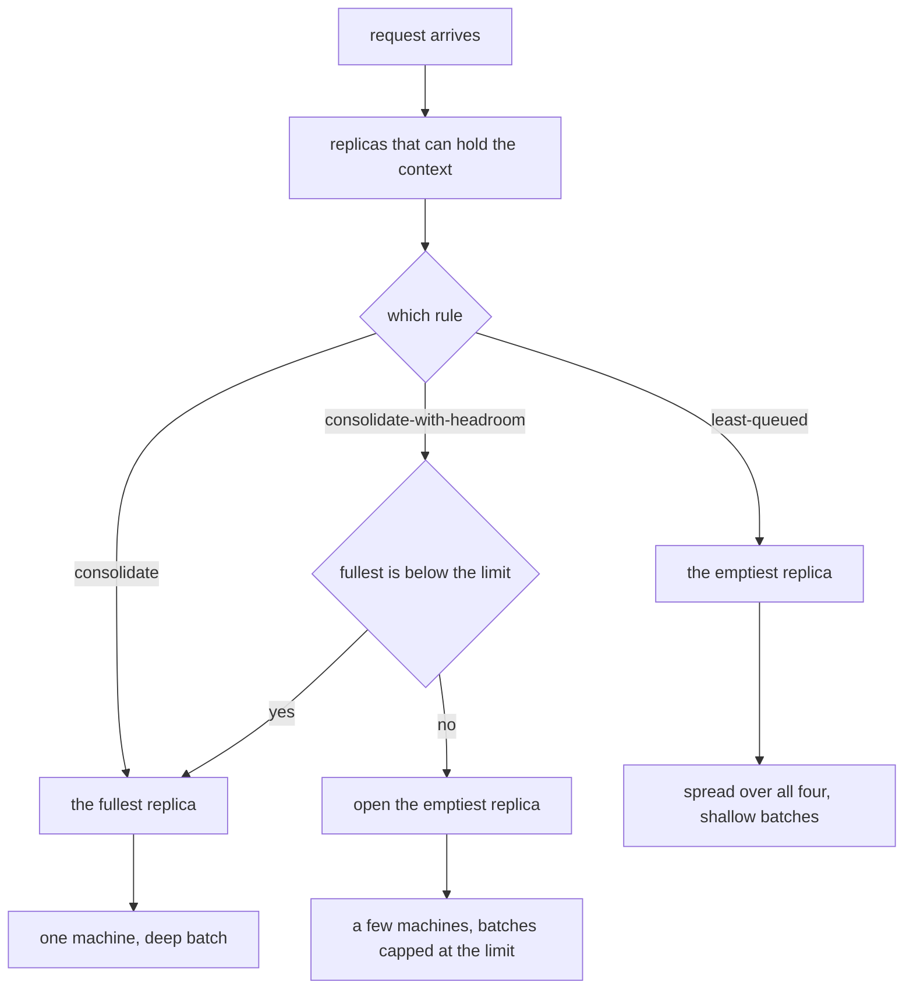

# Example 12: consolidate a fleet to fill batches, or spread to hold latency

## Intention

A load balancer opens a fresh replica the moment one has any work, because the fastest way to answer
one request is to hand it an idle machine. That is right when latency is the only objective, but it is
not free. A decode batch is where a serving engine amortises the cost of reading the weights: four
machines each running a batch of one read those weights four times to do the work that one machine
would do with a batch of four. Consolidation is the other end of the same dial, and it is the choice
behind the "pack the fleet so the idle machines can power down" idea from datacenter scheduling.

This example runs that dial on a fleet of identical clones, where the machines are interchangeable and
so every difference between two runs comes only from how full each batch is and how many devices ever
leave their idle power. Three placement rules share one fleet under the same traffic:

- `least-queued`, the built-in balancer, which sends each request to the replica holding the fewest
  and so spreads the load across all four;
- `consolidate`, which always chooses the most loaded replica that can still hold the context, so one
  machine fills to its batch ceiling before the next opens;
- `consolidate-with-headroom`, which packs the same way but stops at a fixed batch size, opening the
  next replica once the fullest has reached it.

The question it answers: what does filling the batches cost the requests, and what does it buy in
energy, on a fleet where nothing about the machines themselves changes?



## The fleet

Four identical replicas serve the same synthetic 1B decoder used in example 10, on four clones of one
invented on-premise machine. Every figure is synthetic; the artifacts repeat this as
`cost_provenance=synthetic`, and the numbers should be read as a comparison of placement rules under a
known service time, never as a prediction about hardware.

| Profile | Replicas | Memory | Bandwidth | fp16 TFLOPS | Idle / active W | Batch ceiling |
|---|---|---|---|---|---|---|
| `server` | 4 clones | 24 GiB | 700 GB/s | 100 | 20 / 300 | 32 |

Traffic is a dense Poisson chat mix, 40 requests per minute per device-equivalent (`ratePerMinute=2400`
over the fleet), the same short-triangle prompt and answer lengths as example 10, and a loose 2 second
first-token target. Three repetitions, seed 1. The rate is chosen so the balancer keeps all four
replicas nearly saturated while a single machine still has just enough headroom to absorb the whole load
in a large batch; that is the regime where the two rules genuinely disagree.

## The two policies

`src/main/java/com/mechalikh/docket/examples/consolidate/ConsolidateRouting.java` is the exact mirror
of `LeastQueuedRouting`: among the replicas that can hold the request it takes the one with the most
requests already inside, ties broken by the lowest identifier, so the traffic concentrates on replica 0
and one machine fills before the next opens. Because a batch amortises the weights, that concentrated
machine processes the whole offered load on its own.

`ConsolidateWithHeadroomRouting.java` extends it and caps the pack at `PACK_LIMIT = 16` sequences. It
still fills the fullest replica, but a replica at or above the limit is skipped, so the request opens
the next machine instead of deepening a batch past the cap. The limit is a property of the policy, not a
load the policy can compute; the reader changes the constant against the batch they want.

## Measured results

One fleet, one workload, three repetitions, seed 1. The four placement outcomes below are freshly
measured from the artifacts in `results/`; latency and energy are pooled over the repetitions, and the
last two columns are read from the per-request table by `consolidation.py` before it is dropped.

| Scenario | Goodput | Interactive SLO met | TTFT mean (s) | TTFT p99 (s) | E2E mean (s) | Queue mean (s) | Fleet utilisation | Peak batch | Energy (Wh) |
|---|---|---|---|---|---|---|---|---|---|
| `least-queued` | 0.998 | 0.998 | 0.010 | 0.024 | 0.363 | 0.002 | 99.7% | 10 | 79.8 |
| `consolidate` | 0.998 | 0.998 | 0.024 | 0.208 | 0.606 | 0.016 | 25.0% | 32 | 24.0 |
| `consolidate-with-headroom` | 0.998 | 0.998 | 0.011 | 0.029 | 0.455 | 0.003 | 46.5% | 17 | 40.1 |

How concentrated each placement actually was, from `consolidation.py`:

```
scenario                     replicas busy   busiest share   requests per replica
least-queued                     4 of 4          27.2%        7780  7302  7007  6491
consolidate                      1 of 4         100.0%       28580     0     0     0
consolidate-with-headroom        3 of 4          59.5%       16993 11556    31     0
```

What the two tables say together:

- Aggressive consolidation is mostly a win at this load. It puts every one of the 9,507 requests on a
  single replica, fills it to the batch ceiling of 32, and drops fleet utilisation from 99.7% to 25.0%.
  Energy falls from 79.8 Wh to 24.0 Wh, about a third of the balancer's, because one busy 300 W machine
  beats three that only ever idle at 20 W and a fourth running shallow batches. Goodput and every
  service-level column are unchanged at 0.998: the 2 second target is loose next to a 1B decoder on a
  100 TFLOPS machine, so the batching saving arrives essentially for free.
- The one thing it does cost is queueing behind a full batch. Mean first-token time rises from 0.010 s
  to 0.024 s and its p99 from 0.024 s to 0.208 s, and end-to-end mean grows from 0.363 s to 0.606 s,
  because each request now waits for a batch of up to 32 to step through. The trade-off is real but
  small against the stated targets, which is exactly why the loose goodput number alone would hide it.
- The headroom guard splits the difference. Capping the batch at 16 makes the traffic open a second
  replica (16,993 and 11,556 requests on the first two), which holds latency at the balancer's level
  (0.011 s mean TTFT, p99 0.029 s) while still saving about half the energy, 40.1 Wh against 79.8 Wh.
  It gives back roughly two thirds of the aggressive saving to buy the latency back.

The regime the example also exposes is what happens when there is no spare machine. A separate measured
run, not committed as an artifact, raises the rate to `ratePerMinute=3600` (60 requests per minute) on
the same fleet. There the aggressive rule can no longer drain its single replica: it keeps the 24.0 Wh
but the queue grows without bound, mean first-token time reaches 24.5 s and interactive goodput
collapses to 0.040. The headroom rule, which opens the next replica before the first saturates, holds
goodput at 0.998 with a 0.012 s mean TTFT at 51.4 Wh, and the balancer holds 0.998 at 80.0 Wh.
Consolidation is cheap insurance only while a packed replica has headroom; the guard is what keeps it
cheap when a burst arrives.

Read this against example 05, where routing gains on a clone fleet were small because the objective was
latency and the replicas were interchangeable: here the effect is large precisely because the objective
is energy, and energy depends on how many devices leave their idle power and how full each batch runs,
which a placement policy controls even when the machines are clones.

## Running it

```bash
mvn -q test-compile
examples/12-replica-consolidation/run.sh
```

The script runs the three scenarios into `results/`, prints the `mean over` line of each, and runs
`consolidation.py`, which reports the busy-replica count and the placement concentration above from the
per-request tables before they are dropped. The policy test lives in
`src/test/java/com/mechalikh/docket/examples/ConsolidateRoutingTest.java` and fixes the pack-onto-the-
fullest rule, the lowest-identifier tie, the cache-refusal, the batch cap, and the fallback that opens a
fresh replica once every candidate is at the limit.

## Limits

- Synthetic model, device and workload, one seed. The four replicas are clones, so the whole effect is
  the batching and power model, not a hardware difference; the machine is invented and the roofline is
  uncalibrated, and the achieved throughput of the device is used, never its published peak.
- Energy is the two-level model's honest consequence of which devices activate, so it is the axis this
  example moves the most. It is still a model of idle-versus-active draw integrated over time, not a
  measured power trace.
- The batch cap is a fixed constant the policy carries; it reads the number of requests inside a replica,
  not that replica's throughput, so it bounds the batch it forms rather than the step time it implies.
- The fleet has spare machines on purpose: the aggressive saving comes from a single replica that can
  still keep up. The overload run shows that when it cannot, the saving turns into a service-level
  breach, which is why the guard exists.
