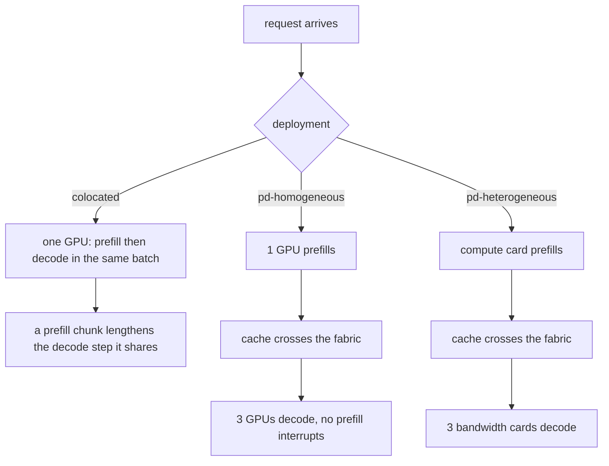

# Example 13: split prefill from decode, first on one card then on two

## Intention

A serving engine that runs both phases of a request on the same machine shares one step between them.
Prefill is the compute-bound pass that reads the whole prompt once and fills the key-value cache; decode
is the memory-bound pass that emits one token at a time and re-reads the weights on every step. When a
chunked prefill lands inside the same batch that is advancing sequences already decoding, it lengthens
that step for every sequence in it. The symptom is a per-token latency with a long tail: most steps take
twenty milliseconds, but the one that carried a prefill chunk takes eighty.

Disaggregation is the standard fix, and the name the competitor comparison marks as a gap in the
simulators around this project. A prompt is prefilled on a pool of machines, its finished cache crosses an
interconnect, and a separate pool generates the tokens into a batch that no prefill ever interrupts. The
question this example answers has two halves, because the literature makes the two claims separately:

- does pulling the phases apart, on identical hardware, remove the interference?
- how much of the benefit is really just the freedom to buy each pool the machine its phase wants?

Three deployments run the same synthetic 7B chat workload at a fixed four-device budget, so every
difference between the rows is the deployment, not the hardware count or the traffic:

- `ex13-colocated`, four identical GPUs, each running prefill and decode in one continuous batch;
- `ex13-pd-homogeneous`, the same four GPUs split into one prefill pool and three decode pools, an
  invented fat interconnect between them, nothing else changed;
- `ex13-pd-heterogeneous`, one compute-rich card for prefill and three bandwidth-rich cards for decode,
  the same one-plus-three split and the same budget.

## The three deployments



All three are invented hardware on a triangular synthetic workload, three repetitions, seed 1. The model
is a 7B dense decoder (14 GB of fp16 weights, 128 KB of key-value cache per context token, so a 1,536-token
prompt reserves 192 MB). The device cost comes from the analytical roofline and is **uncalibrated**: the
numbers compare the three deployments under one service-time model, and are not a prediction about any
real card. Every row carries `cost_provenance=synthetic` and the console repeats `overall provenance :
synthetic`.

| Deployment | Devices | Fleet | Interconnect | Workload |
|---|---|---|---|---|
| `ex13-colocated` | 1 profile `gpu` | 4 clones, all prefill and decode | none | Poisson 300/min, prompts 128-1536 tri, outputs 48-384 tri, 2 s first-token target, 0.1 s per-token target |
| `ex13-pd-homogeneous` | 1 profile `gpu` | 1 prefill + 3 decode | 400 Gbps, 0.5 ms | identical |
| `ex13-pd-heterogeneous` | 2 profiles `compute`, `memcard` | 1 compute + 3 memcard | 400 Gbps, 0.5 ms | identical |

The two device profiles of the heterogeneous run are chosen for their phase: `compute` is 150 fp16 TFLOPS on
a 24 GiB card (prefill is compute-bound), and `memcard` is 3,350 GB/s on an 80 GiB card (decode is
memory-bound and wants room for a wide batch). The homogeneous run keeps the single `gpu` profile, 100 TFLOPS
and 700 GB/s on 24 GiB, so its only difference from the colocated baseline is the split.

## The mechanism

Disaggregation is opt-in and read entirely from the `deployment.*` keys; a scenario that leaves them out is
colocated and behaves exactly as every other example in this repository.

- `deployment.disaggregated=true` builds the fleet from two counts instead of the `replicas` list. It
  refuses a scenario that sets both, so a half-specified deployment cannot silently fall back to one pool.
- `deployment.prefillReplicas` and `deployment.decodeReplicas` size the two pools. The profiles are assigned
  to the stages in declaration order, so the first device listed is the prefill pool and the second the decode
  pool; with one profile both pools clone it.
- `deployment.fabric` names an interconnect carrying `link.<fabric>.capacityMbps` and `link.<fabric>.latencyMs`.
  The finished cache is charged onto that bearer as `cachedTokens x kvBytesPerToken` bytes, so the hand-off is
  a store-and-forward transfer, not a free hop.
- Each replica carries a role. A prefill device computes the prompt's cache and hands the sequence off; a
  decode device receives it and generates into a batch that no prefill joins. The per-replica console lines
  below are the evidence: a prefill device reports prefill steps and zero decode iterations, and a decode
  device reports the reverse.
- On the decode side a transferred sequence is already cached, so it is adopted straight into decoding; the
  queue of a decode device never re-prefills it. A batch ceiling can be set per profile (`replica.compute.maxBatchSize`,
  `replica.memcard.maxBatchSize`) because the two phases want different batch shapes.

The engine treats the hand-off as a moment when the sequence belongs to no replica, exactly like a prompt in
flight on an access link: if the interconnect outlasts a client's patience, the request ends as a cancellation
on the fabric rather than queueing work nobody wants any more.

## Measured results

Pooled over every row of every repetition. The numbers below are freshly measured from the artifacts in
`results/` at a fixed four-device budget; read them against each other, never as a latency for a card that
does not exist.

| Deployment | Goodput | TTFT mean (s) | TTFT p99 (s) | TPOT mean (s) | TPOT max (s) | E2E mean (s) | E2E p99 (s) | tokens/s | Fleet util | Energy (Wh) |
|---|---|---|---|---|---|---|---|---|---|---|
| `ex13-colocated` | 0.9834 | 0.1335 | 0.3112 | 0.0237 | 0.0830 | 4.700 | 8.470 | 940.7 | 0.998 | 99.85 |
| `ex13-pd-homogeneous` | 0.9859 | 0.1774 | 0.5264 | 0.0211 | 0.0219 | 4.255 | 7.597 | 941.6 | 0.877 | 88.47 |
| `ex13-pd-heterogeneous` | 0.9966 | 0.0984 | 0.2726 | 0.0043 | 0.0044 | 0.923 | 1.609 | 948.2 | 0.725 | 97.44 |

The role split behind those pooled figures, read from the per-replica console lines of one repetition:

| Deployment | prefill device | decode devices |
|---|---|---|
| `ex13-colocated` | all four run both: ~2,790 prefill steps and ~50,000 decode iterations spread over four GPUs, batch mean 5.6, peak 10-11 | (same GPUs) |
| `ex13-pd-homogeneous` | `gpu-p1`: 2,795 prefill steps, **0 iterations**, util 51.3% | `gpu-d1/2/3`: **0 prefill steps**, ~14,200 iterations each, batch mean ~6.5, peak 11, util ~100% |
| `ex13-pd-heterogeneous` | `compute-p1`: 2,795 prefill steps, **0 iterations**, util 35.4% | `memcard-d1/2/3`: **0 prefill steps**, ~55,000-65,000 iterations each, batch mean ~1.5, peak 4, util 78-92% |

What the two tables say together:

- **Separation removes the decode-step interference, and nothing else about the hardware moved.** On the
  identical `gpu` cards, the colocated per-token time averages 0.0237 s but spikes to 0.0830 s: that 3.5x tail
  is a chunked prefill landing inside a running batch. Split onto the same four cards, the decode pool's
  per-token time is 0.0211 s with a maximum of 0.0219 s. The tail is gone because no prefill ever joins a decode
  step. Goodput and throughput are unchanged (0.9859 versus 0.9834, 941.6 versus 940.7 tokens/s), which is the
  honest reading: the win is the shape of the latency, not the volume.
- **But separation, alone, costs first-token time.** The homogeneous run's TTFT mean rises to 0.1774 s and its
  p99 to 0.5264 s, against 0.1335 s and 0.3112 s colocated, and its queueing mean nearly triples to 0.0704 s.
  One prefill GPU now serialises every prompt, and the console shows it: that single `gpu-p1` reaches the whole
  workload's 2,795 prefill steps at 51.3% utilisation while the three decode cards run flat out. The bottleneck
  just moved from "interference inside every batch" to "a queue in front of one prefill card."
- **Specialisation is where most of the value lives.** Give prefill the 150 TFLOPS card and decode the 3,350
  GB/s cards, on the same one-plus-three split and budget, and it dominates the baseline on every objective:
  TTFT 0.0984 s (p99 0.2726 s, better than both), per-token time 0.0043 s with no tail at all, end-to-end mean
  0.923 s against the colocated 4.700 s, goodput 0.9966. The fast decode cards emit a step in four milliseconds
  and drain each sequence before a wide batch ever forms (decode peak of 4, not 11), so fleet utilisation drops
  to 0.725 while every latency objective improves. This is the freedom that a colocated fleet cannot take: it
  buys one machine for both phases, so it buys the compromise.
- **Energy is roughly flat across the three.** The homogeneous split is the cheapest (88.5 Wh) because its
  single prefill card idles half the time; the heterogeneous split (97.4 Wh) and the colocated baseline (99.9 Wh)
  are close, since the bandwidth-rich decode cards draw more at full tilt than they save on the idle prefill.
  Here disaggregation is bought for latency, not for power.

Read this against example 12, where the machines were interchangeable clones and placement only moved energy.
The effect here is large on *latency* precisely because the two phases want different machines, which is the
one thing a colocated fleet cannot express.

## Running it

```bash
mvn -q test-compile
examples/13-prefill-decode-disaggregation/run.sh
```

The script runs the three deployments into `results/`, prints each `mean over` line, and keeps the aggregate
artifacts (`config.txt`, `console.txt`, `slo.csv`, `summary.csv`) while dropping the per-request tables. The
mechanism and the state transitions it introduces are covered by
`src/test/java/com/mechalikh/docket/unit/DisaggregationScenarioTest.java` (the `deployment.*` keys, the refusal
of a half-specified fleet, the role assignment and the per-profile batch ceiling) and
`src/test/java/com/mechalikh/docket/integration/DisaggregationIntegrationTest.java` (that the first-token penalty
equals the fabric transfer, that doubling the interconnect capacity halves the charge, that a prefill device
records only prefill steps and a decode device only iterations, the invariant checks, and that a slow fabric leaves
an in-flight cancellation recorded rather than lost).

## Limits

- Synthetic model, synthetic cards, synthetic interconnect, uncalibrated roofline, one seed. The cards do not
  exist, so the comparison is between three deployments under one service-time model, never a benchmark of a
  real GPU. The achieved throughput of the device is used, not its published peak.
- The fabric is a fixed capacity and latency the scenario supplies by hand. Its contribution to first-token
  time is charged exactly (the tests pin that), but it is a store-and-forward byte model, not a switch with its
  own queueing or contention.
- The prefill-plus-decode pools are sized by the reader (`deployment.prefillReplicas` / `decodeReplicas`) and
  held fixed for the run. The one-plus-three split is chosen for this decode-heavy traffic; a different mix of
  prompt and answer lengths would want a different ratio, and the engine does not tune it.
- Cache transfer here moves a whole prompt's key-value block set on every hand-off. Systems that overlap the
  transfer with prefill, or page it, would show a smaller first-token penalty than the one recorded here.
