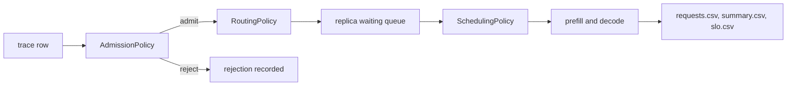

# Worked examples

Thirteen worked examples, one directory each. Twelve test an admission, routing or scheduling
policy; the thirteenth measures a deployment choice, prefill/decode disaggregation against
colocated serving. Every directory holds its scenarios, a `run.sh` that replays them, the results of
the replay committed next to it, and a page explaining what is under test and what the replay
measured. Nine of the policy examples also hold the policy itself as Java source; the other three
use the built-in policies or a replica setting through a scenario file, because a configuration is a
policy too.

The examples exist to be copied. The simulator ships four admission rules, three routing policies
and four scheduling policies; this directory shows how they are chosen, how they are combined, and
how to write one that is not shipped. It also shows that routing is not only about latency: example
10 places requests across device tiers of different speed, cost and power, example 11 places them
across an access link whose transfer tax depends on the bearer, and example 12 packs or spreads a
fleet of identical clones to trade energy against the time a request waits behind a full batch.



## The examples

| Directory | Kind | Policy under test | What the replay measures |
|---|---|---|---|
| `01-sla-earliest-deadline-first` | scheduling | custom `edf` against built-in `fcfs` and `priority` | interactive TTFT attainment 0.147 (`fcfs`) against 0.962 (`edf`) and 0.984 (`priority`) |
| `02-sla-admission-protection` | admission | custom `interactive-reservation` against `unlimited` | interactive attainment 0.147 against 0.951, at the cost of 45 refused batch requests |
| `03-class-fair-share` | routing | custom `class-objective` against `least-queued` | interactive attainment 0.760 against 0.912, batch unchanged at 1.000 |
| `04-session-affinity` | routing | custom `session-affinity` against `least-queued` | turns that return to the previous replica: 22.8% against 100% |
| `05-weighted-load-routing` | routing | custom `weighted-load` against `least-queued` | interactive attainment 0.760 against 0.772, peak cache 81.0% against 77.7% |
| `06-composite-admission` | admission | `cache-capacity` and `queue-limit` in both orders | the same 550 requests served, refusal reasons attributed differently |
| `07-deadline-abort` | replica setting | `abortOnDeadlineMiss` off and on | 31 requests ended as `deadline_missed`, batch attainment 0.925 against 0.974 |
| `08-policy-sweep` | scheduling | the three built-in orders on one trace | interactive attainment 0.760, 0.994 and 1.000 for `fcfs`, `priority`, `shortest-expected-first` |
| `09-custom-policy-template` | scheduling | a hand-written copy of `fcfs` | the same run, row for row, as the built-in policy |
| `10-edge-first-placement` | routing on a tiered fleet | custom `edge-first` and `edge-first-within-budget` against `least-queued` and `least-predicted-work` | interactive goodput 0.208 for a pure edge preference against 0.993 with a first-token budget, edge share 100% against 43% |
| `11-access-link-offloading` | routing over a bearer | custom `offload-small-prompts` against `least-predicted-work`, on a narrow and a fat link | goodput 0.897 against 0.992 on a 50 kbps bearer while offloading twice as many requests, both 0.996 on a 100 Mbps bearer |
| `12-replica-consolidation` | routing on a clone fleet | custom `consolidate` and `consolidate-with-headroom` against `least-queued` | energy 24.0 Wh packing one replica against 79.8 Wh spreading four, the headroom guard holding balancer latency at 40.1 Wh |
| `13-prefill-decode-disaggregation` | deployment choice | prefill/decode split onto separate pools, identical and specialised, against colocated | goodput 0.9834 colocated against 0.9859 disaggregated on one machine type and 0.9966 on specialised pools; decode TPOT max 0.0830 s colocated against 0.0219 s when the phases no longer share a step |

Every figure above was measured on this branch with the committed scenarios and seed 1. The trace
replays run one repetition because a replayed trace is deterministic; examples 10, 11, 12 and 13
drive a random Poisson workload, so they run three and report the run-to-run spread. The per-example
pages give the full tables and the console captures are in each `results/` directory.

## Shared workload data

`data/` holds three committed traces that the examples replay, all synthetic and all regenerable
from `data/generate_sla_mix.py` at the seed recorded in the script:

| File | Rows | Span | Content |
|---|---|---|---|
| `sla-mix.csv` | 600 | 220 s | 30% interactive turns with a 1.5 s TTFT target, 70% batch work with a 15 s and a 300 s target |
| `sla-mix-dense.csv` | 600 | 80 s | the same mix offered 2.75 times faster, which saturates four replicas |
| `session-chats.csv` | 400 | 12.9 s | 80 conversations of five turns each, every turn carrying its session identifier |

The targets travel with each row, so `slo.csv` separates the classes and `attainment` means what
each class asked for, not a target the scenario invented afterwards. A replay draws nothing at
random, so a repetition is identical to the one before it and every trace-replay scenario sets
`experiment.repetitions=1`. Examples 10, 11, 12 and 13 are the exception: they generate Poisson
arrivals rather than replaying a committed trace, so they run three repetitions and report the spread.

## Layout and conventions

```
examples/01-sla-earliest-deadline-first/
  README.md                  what it demonstrates and what it measured
  run.sh                     replays every scenario of the example
  scenarios/*.properties     one file per policy being compared
  results/<experiment>/      console.txt, summary.csv, slo.csv, config.txt
  src/main/java/...          the policy, for the nine examples that write one
```

The policy sources under `examples/*/src` are compiled into `target/test-classes` by
`build-helper-maven-plugin`, so they are on the classpath for a run but never enter the published
jar. `results/` keeps the four small artifacts and drops the per-request `repNN/` tables, because
they are large and regenerate in seconds. Four examples read a per-request table before dropping it,
because their claim is about where a request landed rather than about a pooled percentile: example 04
reads `rep01/requests.csv`, and examples 10, 11 and 12 run three repetitions and read all three before
removing them.

## Running an example

```bash
mvn -q test-compile            # compiles the simulator and the example policies
examples/01-sla-earliest-deadline-first/run.sh
```

Every script takes an output root, so a replay can be written anywhere:

```bash
examples/06-composite-admission/run.sh target/ex06-check
```

A script exits non zero and names the failed scenario if a run fails; the console of the failed
run is in its `results/` directory. Running a script rewrites the committed captures, so a
changed result shows up in `git diff`.

A scenario can also be run directly, with the classpath that `examples/common.sh` builds:

```bash
java -cp "target/classes;target/test-classes;target/lib/*" com.mechalikh.docket.cli.Main \
  -o target/experiments examples/05-weighted-load-routing/scenarios/ex05-weighted.properties
```

The separator is `;` on Windows and `:` elsewhere, which is why the scripts set it from `uname`.

## What these examples do not show

- The device, the model and the cost model are synthetic and uncalibrated, exactly as in the rest
  of the repository. A policy that wins here wins on the accounting this simulator models, and the
  console prints `overall provenance : synthetic` on every run.
- Each trace comparison uses one seed and one repetition, because a replayed trace is deterministic;
  examples 10, 11, 12 and 13 drive a random Poisson workload, so they run three seed-fixed repetitions and
  report the spread. The traces are committed, so a changed result still shows up in `git diff`.
- Example 11 is the only example that crosses the client-to-site access link, and it shows why: a text
  prompt is only kilobytes, so one-hop transfer is negligible on a fat bearer and decides the placement on
  a narrow one. The routing policy sees neither the capacity nor the latency of the link, so the example
  reaches the bearer through a fixed prompt-size threshold rather than a live estimate.
- Example 13 is the only example that charges a bearer inside the deployment, and only for the key-value
  hand-off between the two pools. It disaggregates within one simulated site, so that hand-off is a queue
  on an invented fabric, not a measured inter-node hop; multi-node placement stays out of scope.
- The traces are a two-class mix and a session trace. They are not a substitute for the four
  public trace replays in `examples/real-traces`, which exercise measured arrivals.
- Prefix caching is not modelled, so the affinity example measures where a conversation lands,
  not a cache saving. Every page states the same limit where it applies.
