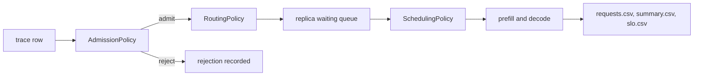

# Policy examples

Nine worked examples of admission, routing and scheduling policies, one directory each. Every
directory holds a scenario, a `run.sh` that replays it, the results of the replay committed next
to it, and a page explaining what the policy is for and what the replay measured. Six of them
also hold the policy itself as Java source; the other three use the built-in policies or a replica
setting through a scenario file, because a configuration is a policy too.

The examples exist to be copied. The simulator ships four admission rules, three routing policies
and four scheduling policies; this directory shows how they are chosen, how they are combined, and
how to write one that is not shipped.



## The examples

| Directory | Kind | Policy under test | What the replay measures |
|---|---|---|---|
| `01-sla-earliest-deadline-first` | scheduling | custom `edf` against built-in `fcfs` and `priority` | interactive TTFT attainment 0.147 (`fcfs`) against 0.962 (`edf`) and 0.984 (`priority`) |
| `02-sla-admission-protection` | admission | custom `interactive-reservation` against `unlimited` | interactive attainment 0.147 against 0.951, at the cost of 45 refused batch requests |
| `03-class-fair-share` | routing | custom `class-objective` against `least-queued` | interactive attainment 0.760 against 0.912, batch unchanged at 1.000 |
| `04-session-affinity` | routing | custom `session-affinity` against `least-queued` | turns that return to the previous replica: 22.8% against 100% |
| `05-weighted-load-routing` | routing | custom `weighted-load` against `least-queued` | interactive attainment 0.760 against 0.772, peak cache 81.0% against 77.7% |
| `06-composite-admission` | admission | `cache-capacity` and `queue-limit` in both orders | the same 550 requests served, refusal reasons attributed differently |
| `07-deadline-abort` | replica setting | `abortOnDeadlineMiss` off and on | 31 requests ended as `deadline_missed`, batch attainment 0.925 against 0.974 |
| `08-policy-sweep` | scheduling | the three built-in orders on one trace | interactive attainment 0.760, 0.994 and 1.000 for `fcfs`, `priority`, `shortest-expected-first` |
| `09-custom-policy-template` | scheduling | a hand-written copy of `fcfs` | the same run, row for row, as the built-in policy |

Every figure above was measured on this branch with the committed scenarios, seed 1 and one
repetition. The per-example pages give the full tables and the console captures are in each
`results/` directory.

## Shared workload data

`data/` holds three committed traces that the examples replay, all synthetic and all regenerable
from `data/generate_sla_mix.py` at the seed recorded in the script:

| File | Rows | Span | Content |
|---|---|---|---|
| `sla-mix.csv` | 600 | 220 s | 30% interactive turns with a 1.5 s TTFT target, 70% batch work with a 15 s and a 300 s target |
| `sla-mix-dense.csv` | 600 | 80 s | the same mix offered 2.75 times faster, which saturates four replicas |
| `session-chats.csv` | 400 | 12.9 s | 80 conversations of five turns each, every turn carrying its session identifier |

The targets travel with each row, so `slo.csv` separates the classes and `attainment` means what
each class asked for, not a target the scenario invented afterwards. A replay draws nothing at
random, so a repetition is identical to the one before it and every scenario sets
`experiment.repetitions=1`.

## Layout and conventions

```
examples/01-sla-earliest-deadline-first/
  README.md                  what it demonstrates and what it measured
  run.sh                     replays every scenario of the example
  scenarios/*.properties     one file per policy being compared
  results/<experiment>/      console.txt, summary.csv, slo.csv, config.txt
  src/main/java/...          the policy, for the six examples that write one
```

The policy sources under `examples/*/src` are compiled into `target/test-classes` by
`build-helper-maven-plugin`, so they are on the classpath for a run but never enter the published
jar. `results/` keeps the four small artifacts and drops `rep01/`, the per-request table, because
it is large and regenerates in seconds. The one exception is example 04, whose claim is about
where requests landed: its script reads `requests.csv` before dropping it.

## Running an example

```bash
mvn -q test-compile            # compiles the simulator and the example policies
examples/01-sla-earliest-deadline-first/run.sh
```

Every script takes an output root, so a replay can be written anywhere:

```bash
examples/06-composite-admission/run.sh target/ex06-check
```

A script exits non zero and names the failed scenario if a run fails; the console of the failed
run is in its `results/` directory. Running a script rewrites the committed captures, so a
changed result shows up in `git diff`.

A scenario can also be run directly, with the classpath that `examples/common.sh` builds:

```bash
java -cp "target/classes;target/test-classes;target/lib/*" com.mechalikh.docket.cli.Main \
  -o target/experiments examples/05-weighted-load-routing/scenarios/ex05-weighted.properties
```

The separator is `;` on Windows and `:` elsewhere, which is why the scripts set it from `uname`.

## What these examples do not show

- The device, the model and the cost model are synthetic and uncalibrated, exactly as in the rest
  of the repository. A policy that wins here wins on the accounting this simulator models, and the
  console prints `overall provenance : synthetic` on every run.
- Each comparison uses one seed and one repetition. The traces are committed and deterministic,
  so repetitions would not add evidence about the policy, only about run-to-run noise, which is
  zero here by construction.
- The traces are a two-class mix and a session trace. They are not a substitute for the four
  public trace replays in `examples/real-traces`, which exercise measured arrivals.
- Prefix caching is not modelled, so the affinity example measures where a conversation lands,
  not a cache saving. Every page states the same limit where it applies.
