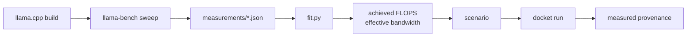

# One engine, one device, measured

Every other scenario in this repository is priced by coefficients chosen by hand. This example
replaces them with two figures fitted to a real serving engine on a real device, and checks that
the simulator reproduces the benchmark it was fitted to.

The device is the laptop CPU that ran the benchmark, not a GPU. That is a limit of the machine
this was measured on, and it is the reason the scenario keeps to batch 1 and a short context: the
coefficients are device-wide, so they can only be trusted as far as the benchmark and the scenario
resemble each other. The next section states exactly what was measured; the last one states what
the result does not cover.



## What was measured

| Item | Value |
|---|---|
| Engine | llama.cpp b12014, CPU backend, `llama-bench.exe` |
| Device | Intel Core i7-8550U, 4 physical cores, 4 threads, 1.8 GHz base |
| Memory | 7.84 GiB, no discrete GPU |
| Model | Qwen2.5-0.5B-Instruct, f16 GGUF, 494,032,768 parameters, 988,208,640 bytes |
| Model SHA-256 | `f1ad9d1174ce6ab47b584d522634c47e411b75bffdffd9a4e106e21e882392e5` |
| Date | 2026-10-30 |
| Repetitions | 5 per point, fresh process, machine idle for one minute before the sweep |

The model is small because no GPU is available and a larger one would not run here. Its
dimensions were read from the GGUF header (parameter count, layer count, tensor shapes) and match
Qwen's published `config.json`: 24 layers, hidden width 896, 14 query heads, 2 key-value heads of
width 64, feed-forward width 4,864, vocabulary 151,936, context 32,768.

Commands, run from the repository root after the build and model are in `target/calibration/`:

```bash
target/calibration/llama/llama-bench.exe -m target/calibration/qwen05b-f16.gguf \
    -p 256,512,1024 -n 128 -d 0 -t 4 -r 5 --prio 2 --delay 5 -o json \
    > examples/calibration/measurements/llama-bench-laptop-cpu-2026-10-30.json

target/calibration/llama/llama-bench.exe -m target/calibration/qwen05b-f16.gguf \
    -p 0 -n 128 -d 0,512,2048 -t 4 -r 5 --prio 2 -o json \
    > examples/calibration/measurements/llama-bench-depth-laptop-cpu-2026-10-30.json
```

The raw captures are committed. `fit.py` reads the first one and prints the two coefficients:

```text
prefill   256 tokens :   86.23 tok/s,   2.9688 s
prefill   512 tokens :   88.05 tok/s,   5.8146 s
prefill  1024 tokens :   83.28 tok/s,  12.2956 s
decode depth    0      :   10.21 tok/s
achieved FLOPS            : 8.4401e+10  (0.0844 TFLOPS)
effective bandwidth       : 1.009595e+10  (10.096 GB/s)
```

Prefill is compute-bound, so the achieved throughput is the total prefill work divided by the
total prefill time. Decode at batch 1 is memory-bound, so the bandwidth is the bytes one step
moves (weights plus the cache read and write) divided by the measured time per token. Both are
effective figures: they absorb the backend's kernel efficiency instead of describing a datasheet.

The spread is not negligible. Prefill samples ranged from 83.0 to 89.2 tokens/s and decode from
9.9 to 10.7 tokens/s across the five repetitions, which is normal for a 15 W mobile CPU with no
usable thermal telemetry. The fit uses the mean of the five, not the best sample.

## What the simulator reproduces

`scenarios/laptop-cpu-qwen05b.properties` declares the measured model dimensions, the measured
device coefficients, `cost.model=roofline-calibrated`, and the benchmark as
`cost.calibration.source`. It offers three requests with a 512-token prompt and a 64-token output,
thirty seconds apart, so every request is alone on the device and nothing queues.

| Point | Measured | Simulated | Difference |
|---|---|---|---|
| Prefill 256 tokens | 2.9688 s | 3.0018 s | +1.1% |
| Prefill 512 tokens | 5.8146 s | 6.0131 s | +3.4% |
| Prefill 1024 tokens | 12.2956 s | 12.0644 s | -1.9% |
| Batch-1 decode, context 63 | 0.09795 s | 0.09794 s | 0.0% |
| Batch-1 decode, context 512 | 0.1126 s | 0.09849 s | -12.5% |

The first four rows are inside the fitted range and agree. The last row is outside it and does
not: llama.cpp's attention kernel on this CPU slows down with context far more than the roofline's
bandwidth term predicts, because the model charges the cache read at the same effective bandwidth
as the weights while the CPU backend does not achieve that on strided key-value reads. The
scenario therefore warns on every estimate, and the page says it rather than hiding it.

The console of the committed run:

```text
cost model           : roofline-calibrated, measured, calibrated on llama.cpp b12014, ...
overall provenance   : measured
rep      offered completed  success  ttft p50  ttft p99   e2e p99   tpot p99  goodput  tokens/s energy J
1              3         3   1.0000    6.0131    6.0131   12.2204   0.09853     0.0000      2.1      0.00
```

`overall provenance : measured` is the point of the example. The same profiles priced by
`roofline-analytical` report `synthetic`, which the unit tests pin.

## Power

The energy model needs the power the machine draws when the replica is idle and when it is busy.
The plan is to measure both from the battery discharge rate with the laptop unplugged, so the
figure would be whole-system: CPU, screen and everything else. That is the right unit for a
single-device deployment and the wrong unit for a GPU server, where the device is one card among
many.

`measure_power.py` records both points:

```bash
python examples/calibration/measure_power.py idle --seconds 60
python examples/calibration/measure_power.py load --seconds 90
```

No power capture is committed yet. The machine used for the benchmark runs on AC, and the script
refuses to record a discharge rate while `PowerOnline` is true, so the two power figures in the
scenario are still zero and its energy column is zero. When an unplugged capture exists it will be
committed under `measurements/battery-power-*.json` and the two values copied into
`device.idlePowerWatts` and `device.activePowerWatts`. Until then this example calibrates service
time only, and the results above say so.

## Limits

- One engine, one device, one model. The coefficients are effective figures for this combination;
  applying them to another model or another CPU is an assumption the calibrated model warns about.
- Batch 1 and short context. The scenario keeps to the fitted regime, and the table above shows
  what happens when it does not.
- The CPU is not the device family this simulator targets. A GPU calibration would need the same
  measurement on the card, which was not available here.
- The model is a 0.5B decoder. Nothing in the fit depends on model size, but the fitted throughput
  includes the backend's efficiency at this size, and that efficiency is not constant.
