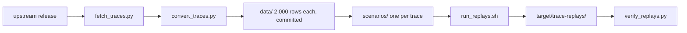

# Real trace replays

This directory replays four public LLM serving traces through the simulator: Azure's conversation
trace, the Qwen-Bailian trace, the Mooncake conversation trace that records Kimi traffic, and
BurstGPT. Each is cut to a 2,000-request window, committed as a CSV file, paired with a scenario and
run once. The point is narrow and worth stating before any number: **the traffic is measured, the
latencies are not.** Arrivals, prompt lengths, generated lengths and request classes come from the
recordings. Engine speed, device memory and power still come from the synthetic roofline model, so
the console prints `overall provenance : synthetic` on every run here.

A fifth scenario replays the Qwen window with the service-level objectives an operator would state
for each class, which is what turns goodput from not applicable into a measured number.

The directory exists because the rest of the repository generates its own arrivals. A reviewer is
right to ask whether the queue, the cache and the scheduler behave under an arrival process
nobody designed. The answer is in the numbers below, and in one scheduler defect the Kimi window
found.



## What is replayed

| Directory entry | Trace | Recorded by | Licence | Window |
|---|---|---|---|---|
| `azure-conv` | Azure LLM inference trace, conversation subset, 2023-11-16 | Microsoft Azure | CC-BY-4.0 | first 2,000 rows, 424.3 s |
| `qwen-traceA` | Qwen-Bailian anonymous trace, `qwen_traceA`, chat-style traffic | Alibaba Cloud | Apache-2.0 | first 2,000 rows, 588.0 s |
| `kimi-conversation` | Mooncake FAST'25 conversation trace | the Kimi serving cluster | Apache-2.0 | first 2,000 rows at or after 2,799,000 ms, 531.0 s |
| `burstgpt` | BurstGPT, first file | a commercial chatbot service | CC-BY-4.0 | first 2,000 rows after 824,947 s, 191.0 s |

Upstream locations:

- Azure: <https://github.com/Azure/AzurePublicDataset>, file
  `data/AzureLLMInferenceTrace_conv.csv`.
- Qwen-Bailian: <https://github.com/alibaba-edu/qwen-bailian-usagetraces-anon>, file
  `qwen_traceA_blksz_16.jsonl`.
- Mooncake: <https://github.com/kvcache-ai/Mooncake/tree/main/FAST25-release/traces>, file
  `conversation_trace.jsonl`.
- BurstGPT: <https://github.com/HPMLL/BurstGPT>, file `data/BurstGPT_1.csv`.

There is no NVIDIA request trace to replay. NVIDIA publishes serving software and AI Perf, its
load generator, but no origin trace of requests to an NVIDIA-operated service. BurstGPT is the
bursty public dataset AI Perf ships and replays, so it stands in for that slot, with the label
saying what it is: a commercial chatbot's traffic, not an NVIDIA workload. The scenario file and
this page repeat the distinction so the run cannot be cited as the latter.

## The committed windows

`data/manifest.json` is the provenance record. It carries the upstream URL, licence, citation, the
SHA-256 of the downloaded file, the window rule, the row count, the arrival span, the mean rate,
the length ranges, the service classes and the rows the converter dropped.

| Window | Rows | Span | Rate | Mean prompt | Max prompt | Mean output | Classes |
|---|---|---|---|---|---|---|---|
| `azure-conv.csv` | 2,000 | 424.259 s | 282.85/min | 1,104.8 | 7,930 | 264.9 | `default` |
| `qwen-traceA.csv` | 2,000 | 587.966 s | 204.09/min | 1,888.5 | 18,177 | 370.9 | `text`, `search`, `image`, `file` |
| `kimi-conversation.csv` | 2,000 | 531.0 s | 225.99/min | 11,662.9 | 126,195 | 330.0 | `default` |
| `burstgpt.csv` | 2,000 | 191.0 s | 628.27/min | 136.4 | 3,103 | 8.9 | `api`, `conversation` |

The four traffic shapes are deliberately different, which is the reason to keep four rather than
one:

- Azure arrives at a steady 283 requests/min with prompts up to 7,930 tokens.
- Qwen mixes four request types and reaches 18,177 tokens, so admission and per-class accounting
  are exercised.
- Kimi is long-context traffic: the mean prompt is 11,663 tokens and one exceeds 126,000, so the
  KV pool, not the context cap, decides how many requests run together.
- BurstGPT packs 2,000 short requests into 191 seconds, so the queue is the object of study.

Two windows are cut from a prefix of a large file. The Qwen fetch stops at 4 MB of the 56 MB
object, and the last JSON line of that prefix is incomplete, so the converter counts it as
`truncated: 1`. The BurstGPT fetch stops at 4 MB of a 50 MB file, and the same happens to its last
line, counted as `missing: 1`. Both counts are in the manifest, and neither affects the 2,000 rows
before them.

## Conversion rules

`convert_traces.py` makes three decisions and records them, so the recordings are not silently
reshaped:

- `arrival_time_s` is the recorded instant minus the first instant of the window. Azure stores
  wall-clock stamps with seven fractional digits, Qwen stores seconds, and Mooncake stores
  milliseconds. The reader normalises each to seconds.
- `model_id` is one identifier per trace and matches `model.id` in the paired scenario.
- `service_class` is the recorded request type where the trace has one and `default` otherwise.
  Qwen's `type` becomes `text`, `search`, `image` or `file`; BurstGPT's `Log Type` becomes
  `api` or `conversation`; Mooncake and Azure carry no type, so their rows stay `default`.
- Every length is kept exactly as recorded. Nothing is clamped, sampled or smoothed. The only
  reordering, if any, is a stable sort, and the manifest reports an `out_of_order` count of 0 for
  all four windows.
- `session_id` is copied where the trace has a session. Qwen's `chat_id` becomes `session_id`;
  Mooncake's `hash_ids` identify a prefix rather than a session and are not mapped; Azure and
  BurstGPT have none. The simulator records the session and does not yet route on it, so the
  column is evidence for a future prefix-caching stage, not an input to this one.

Lengths are the provider's token counts. A Qwen token is not a token of this synthetic 7B model,
so the counts are an approximation of its tokenizer, and the error is systematic. The replay uses
them unchanged because rewriting them with a local tokenizer would add a model without adding
measurement.

## The scenarios

Each scenario is a copy of the synthetic 7B decoder used by the rest of the repository:

- 7B dense transformer, 32 layers, 32 KV heads of dimension 128, fp16, so the cache costs
  524,288 bytes per token.
- One synthetic 80 GiB accelerator with 3,350 GB/s of memory bandwidth, 700 TFLOPS fp16 achieved,
  50 W idle and 700 W active. The note in the file says the figures are round numbers chosen to
  hold long prompts, not a measured card.
- Continuous batching with a batch ceiling of 64, a prefill chunk of 512 tokens, 16-token blocks
  and newest-first preemption.
- `workload.prediction=trace-observed`, the only prediction mode under which a length-aware policy
  is not cheating on a replay.

The traces state no service-level targets, so the four plain replays leave every SLO column not
applicable and `goodput` at `0`, because no request stated an objective. This is not a missed SLO,
and `slo.csv` prints the class row with dashes. A trace that carries targets can state them per
row with `ttft_target_s`, `e2e_target_s` and `tpot_target_s`; none of these four does.

`qwen-traceA-objectives.properties` is the fifth scenario, and the one that answers the gap. It
replays the same window on the same device and states what each class is promised:
`workload.ttftTargetSeconds.<class>` and its `endToEnd` and `tpot` siblings, one triple each for
`text`, `search`, `image` and `file`. Half a second to the first token and 50 tokens per second
after it for a chat turn, more slack for search and image, and a background budget for a file
upload. These four triples are the only inputs in this directory that are an assumption rather
than a recording, and the scenario header says so. Everything else it uses is the plain replay's.

Kimi is the one deliberate departure: it runs on **32 replicas**. The window is traffic to a
cluster, and one prompt in it asks for 126,195 tokens, which is nearly a whole 80 GiB device of
cache. Replaying a cluster's rate on one device would measure a queue of our own making, not the
trace. Thirty-two devices drain the recorded arrivals, and the per-replica console lines are the
evidence that no single device is oversubscribed. This also means the 1,132 Wh in its `summary.csv`
is the energy of 32 synthetic devices for fifteen minutes, not of one server; its aggregate
utilisation of 14.1% is the fraction of those 32 device-seconds that were busy.

## Running them

The windows are committed, so a replay needs no network:

```bash
mvn -q package
examples/real-traces/run_replays.sh          # writes target/trace-replays
```

The script runs each scenario in its own JVM, saves the console report next to the artifacts and
ends with `REPLAY_CHECK OK` when `verify_replays.py` reconciles all four runs. The check compares
`target/trace-replays/<name>/rep01/requests.csv` with `data/<name>.csv` as multisets of (arrival
instant, prompt length, requested output length, service class). It reports the largest arrival
difference and every unmatched or extra row. The archived run:

```text
azure-conv         OK rows=2000 max_arrival_diff=0 s unmatched=0 extra=0
qwen-traceA        OK rows=2000 max_arrival_diff=0 s unmatched=0 extra=0
kimi-conversation  OK rows=2000 max_arrival_diff=0 s unmatched=0 extra=0
burstgpt           OK rows=2000 max_arrival_diff=0 s unmatched=0 extra=0
REPLAY_CHECK OK
```

The reconciliation is over the whole window rather than a subset: `offered` is 2,000 in all four
`summary.csv` files, and every row was released. Three windows complete all 2,000. Qwen completes
1,972 and refuses 28 at admission for lack of cache, which is the run's own policy decision
recorded as `rejected:admission_no_cache_capacity`, not a lost request.

To rebuild a window from upstream:

```bash
python examples/real-traces/fetch_traces.py             # target/traces-cache, gitignored
python examples/real-traces/convert_traces.py           # rewrites data/ and manifest.json
python examples/real-traces/verify_replays.py --help
```

`fetch_traces.py` uses HTTP Range requests for the two large files, so it downloads 4 MB rather
than 106 MB. `convert_traces.py` prints the SHA-256 of the cache file it read, so a changed
upstream release is visible in the diff of `manifest.json`.

## Measured results

All four runs used seed 1, one repetition, the jar built from this branch. The console captures,
`summary.csv`, `slo.csv` and `config.txt` of each run are in `results/<name>/`.

| Trace | Completed | TTFT mean / p99 (s) | E2E mean / p99 (s) | Output tok/s | Energy (Wh) | Utilisation | Batch mean / peak |
|---|---|---|---|---|---|---|---|
| `azure-conv` | 2,000/2,000 | 0.0301 / 0.1083 | 1.9251 / 4.8350 | 756.9 | 84.25 | 0.590 | 8.42 / 28 |
| `qwen-traceA` | 1,972/2,000 | 0.0613 / 0.3724 | 5.7935 / 25.8029 | 660.1 | 123.93 | 0.547 | 15.08 / 44 |
| `kimi-conversation` | 2,000/2,000 | 0.5956 / 5.6400 | 3.1764 / 14.0258 | 733.4 | 1,132.34 | 0.141 | 0.76 / 2 |
| `burstgpt` | 2,000/2,000 | 0.0350 / 0.1198 | 0.1038 / 1.1348 | 44.7 | 16.38 | 0.150 | 1.52 / 20 |

What the table does and does not say:

- It says the engine accepts a measured arrival process without dropping or duplicating a request,
  and that the cache and scheduler stay live under all four shapes, including long prompts.
- It says the queue behaves as the load predicts. BurstGPT finishes each request in about a
  tenth of a second because its outputs average 9 tokens, so 44.7 tok/s is a property of the
  trace's short responses, not of a slow engine. Kimi moves 733.4 tok/s per device because long
  prefills dominate and each device mostly holds one request.
- It does not say an Azure, Qwen or Kimi server would see these latencies. They come from the
  roofline model with a synthetic device and no calibration. The trace fixes the work, not the
  speed at which the work is done.
- Energy is the integral of the two-level power model over the simulated run. Kimi's 1,132 Wh is
  32 devices idling at 50 W for fifteen minutes even where they are not busy, which is why the
  utilisation column belongs next to it.

The objectives replay reports the same latencies, since it differs from the plain Qwen replay only
in what the requests are promised, and it turns those latencies into attainment:

| Class | Offered | Completed | TTFT | E2E | TPOT | All three |
|---|---|---|---|---|---|---|
| `text` | 1,428 | 1,411 | 0.987 | 0.961 | 0.777 | 0.752 |
| `search` | 377 | 370 | 0.981 | 0.981 | 1.000 | 0.981 |
| `image` | 116 | 116 | 1.000 | 1.000 | 1.000 | 1.000 |
| `file` | 79 | 75 | 0.949 | 0.949 | 1.000 | 0.949 |

Goodput is 1,635 of 2,000 offered requests, 0.8175, and the binding objective is the per-token
pace of the chat class: 1,096 of the 1,411 text requests that completed streamed at 50 tokens per
second or faster, and 315 did not. The first token and the end-to-end latency are met almost
everywhere. That is the kind of statement the plain replays cannot make, and it is only as good as
the four objective triples, which are stated in the scenario rather than recorded.

## The defect the Kimi window found

Replaying the Kimi window, whose prompts reach 126,195 tokens, exposed a liveness bug that the
synthetic scenarios never reached. A prefill that suspends for lack of cache kept the blocks of the chunks it
had already reserved. If enough suspended prefills sat at the head of a replica's queue, they could
hold the pool while the running batch needed one more block to continue. Prefill could not reserve,
decode could not progress, and preemption had no running victim to recompute. The replica stopped
with work in hand.

The first replay of the original 600-row window showed it plainly: one device completed 5 of the
600 requests. Eight devices preempt-thrashed, recording 42,743 preemptions while 13 requests
stayed stuck for the whole run. Thirty-two devices still left 2 requests stuck. The run is
deterministic, so the failure was not intermittent.

The fix is in `ReplicaServer`: when the loop finds nothing it can schedule and the running batch
cannot proceed, the queued requests give their cached chunks back once, and the batch gets the
first refusal on the blocks just released. Giving the cache back only at the stall keeps the
ordinary case unchanged, which is why the two pinned regression scenarios did not move. The
regression test `aTraceWhoseSuspendedPrefillsFillTheCacheStillCompletesEveryRequest` builds three
8,000-token prompts on a 20,900-token cache; it completes 0 of 3 without the fix and 3 of 3 with
it. The suite is 151 tests, all passing.

## What this validates, and what it does not

Validated by the reconciliation:

- arrivals, prompt lengths, generated lengths and service classes are released exactly as
  recorded, after the documented conversion;
- every row is admitted and completed, so the window is replayed whole;
- the scheduler, the paged cache and the queue remain live and accounted under four different
  measured arrival processes, and the invariant checks in `RunResult` pass for every run.

Not validated, and not claimed:

- latency, tokens/s and energy are analytical. The device is synthetic and the cost model is
  uncalibrated, so the console prints `overall provenance : synthetic` and each row carries
  `cost_calibrated=no`.
- prefix hashes are not modelled. Qwen and Mooncake record `hash_ids` that a prefix-caching engine
  would use; this simulator has no cross-request prefix cache, so the converter does not map them
  and the replay does not use them.
- SLO targets are absent from the traces, so the four plain replays report no attainment. The
  objectives replay does, against objectives stated in the scenario, and its goodput is a
  statement about that assumption as much as about the device.
- the provider tokenizer differs from the synthetic model's, so token counts are approximate.
- the windows are 2,000 rows each, cut from releases that are orders of magnitude larger. They are
  representative of the traffic at their position, not of the whole file.

The remaining gap is calibration. These replays make the traffic half of the evidence measured and
leave the service-time half analytical; a calibrated cost model is what would close it, and the
repository states that limit everywhere a number is printed.
